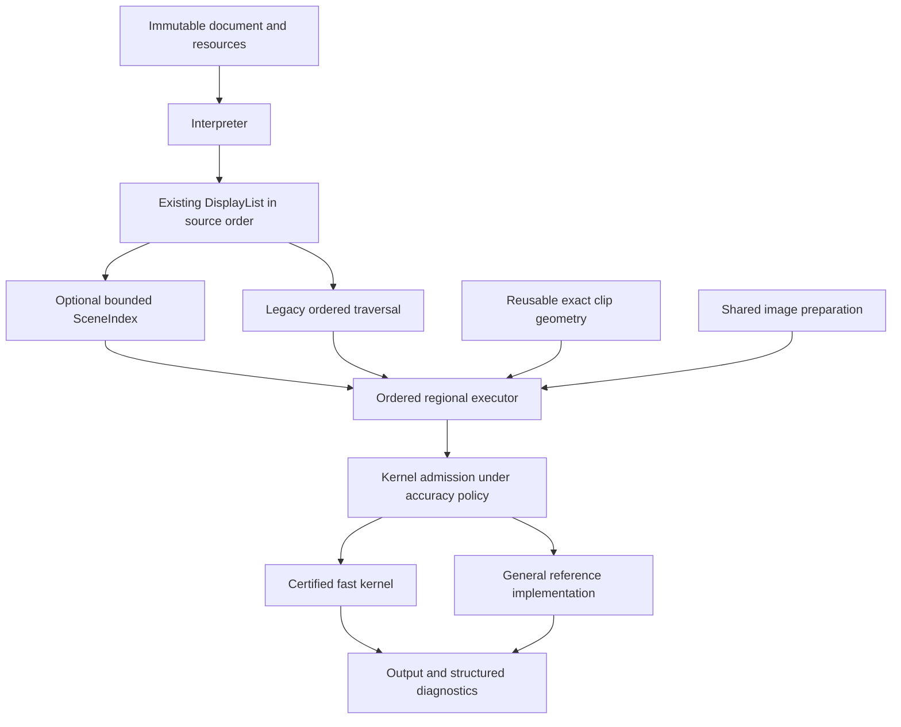

# ADR 0016: Unify rendering through shared geometry and certified execution

Status: proposed, 2026-10-20. Architecture and implementation plan only; no
renderer behavior, public default, fixture tolerance, or release gate changes.

## Context and evidence boundary

The design is based on commit `359e19dda5b78a23675678b6a153da7ab7fdc2c5`
on `hq/upbeat-mirzakhani-fc30a7`. The planning branch is
`codex/unified-renderer-plan`. No build, profile, benchmark, or conformance run
was performed for this proposal. Performance opportunities below are hypotheses.

Exact and Competitive share much of the implementation but select different
geometry, storage, font-loading, and image paths. Exact retains ADR 0004's
one-level contract. Competitive deliberately changes glyph placement, curve
approximation, geometric clipping, and accumulation. Some useful mechanisms
currently gated by Competitive may nevertheless meet the strict contract.

The frozen source already includes fixed-grid coverage certificates with
fallback, admitted true-quadratic glyph coverage, N16/F32 storage admission,
row fragments, direct image filtering, and retained host display lists. These
are foundations, not new work proposed here. The observed remaining seams are:

| Existing owner | Observation | First intervention |
|---|---|---|
| `pagura-render/src/compositor.rs` | Each band/chunk traverses the command list. | Optional, bounded command-to-region index. |
| `pagura-raster/src/coverage/accumulation.rs`, `raster/reuse.rs` | Exact reconstructs joint geometry; Competitive can multiply marginal clip coverage. | Reusable exact clip geometry for a narrow admitted subset. |
| `pagura-render/src/compositor/plan.rs` | Precision selection is conservative across a page. | Later, independent group/region admission with end-to-end error proof. |
| `pagura-render/src/direct_image.rs`, `context.rs`; `pagura-host/src/session.rs` | Direct and retained routes do not share all specialization; direct tiles can paint the page before cropping. | Requested-rectangle execution, then common image plans. |

Paths in this table are relative to `crates/`. The active worktree had a pending
ADR 0004 correction describing matte removal per source sample. The source at
the frozen commit already performs per-sample removal; this proposal uses that
behavior and does not transplant the other worktree's pending edit.

## Decision proposed

Keep one semantic display list. Introduce internal, optional preparation and
execution components incrementally, selected by explicit correctness
preconditions. Preserve the current general renderer as fallback. Share
verified implementations between policies; keep approximation an explicit
policy, never a hidden response to pressure on time or memory.

This is not a new public `PreparedPage` API, a new crate, a plugin registry,
or a generic execution framework. Start with private concrete types in
`pagura-render`; add abstractions only when two proven implementations need
them. Raster geometry remains PDF-agnostic in `pagura-raster`.

## Ownership and interfaces

Names below are proposed internal seams, not already implemented APIs.

| Component | Owner and lifetime | Contract |
|---|---|---|
| `DisplayList` | Existing `display.rs`; immutable page semantics | Remains authoritative for commands, groups, resource identity, and source positions. |
| `SceneIndex` | New `compositor/index.rs`; initially one render call | Stores stable group-local command ordinals and conservative spatial incidence. Does not clone commands, decode resources, or issue diagnostics. |
| Ordered command selection | `compositor.rs`, `compositor/index.rs`, existing `compositor/regions.rs` bounds authority | Merges indexed and broadcast entries in original order, exactly once. Initially treats groups as indivisible broadcast commands. |
| `PreparedClip` | Geometry in `pagura-raster`; PDF clip-chain adapter in `pagura-render`; initially one render call | Full/outside runs plus boundary geometry, fill rules, and original geometry for fallback; never a PDF soft mask. Cross-call retention requires M0. |
| Kernel admission | Existing `compositor/plan.rs`, split only as needed | Private enums distinguish certified execution, explicit legacy approximation, and general fallback. Constructor checks carry the proof obligations; a boolean named `exact` is insufficient evidence. |
| Image preparation | Existing `direct_image`, `compositor/images`, `interpreter/images` modules | Share eligibility and sample semantics first, requested-region execution next, lazy production later. |
| Render retention accounting | `context.rs`, coordinated with host cache accounting | Reserve and release actual retained capacities and bookkeeping before publication. Separate document, rendering, host, and transient budgets explicitly. |

A command ordinal is scoped to its owning group and immutable display list.
Indices never address a rebuilt list by an old ordinal. SceneIndex accepts
the canonical page-to-device transform and page extent, not caller tile order.
An unknown or non-finite bound, state-sensitive operation, or unproved omission
rule means broadcast/legacy execution, not empty coverage.

## Spatial scheduling without changing semantics

The first renderer experiment, **S0a**, tested lazy reuse of existing glyph-run
hulls in `compositor/index.rs`, retaining full command traversal. Eligibility
was limited to the first 64 root command ordinals, runs with at least two glyph
sources, repeated bands/chunks, and finite ordered bounds under the canonical
transform. Groups and other scopes used the existing path. The first hull was
computed after the same semantic work charges; later visits reused its bits.
Visibility, padding and rounding stayed in `regions.rs`.

The historical candidate used a fixed 2,064-byte index object on the measured
native target, including disabled instances. That was object size, not measured
total stack-frame growth. It was outside the decoded-heap/surface allowance,
allocated no heap storage, performed no preparatory geometry pass, and did not
change semantic budget admission. The object and its reuse path have now been
removed; this experiment does not waive the live-memory rules below for future
dynamic preparation. Sparse command dispatch remains S1 and is not implemented
by this experiment.

The [experiment record](../../benchmarks/results/scene-index-experiment.md)
preserves the pilot and successful correctness checks. Final confirmation005
refused external contention before launching any benchmark child and produced
zero measured samples. Under the keep-only-if-all-gates-pass rule, the memo was
[removed without admission](../../benchmarks/results/scene-index-decision.json).
No numerical speed or memory regression was established by that refusal.

The next isolated candidate delayed clip viewport construction until the
soft-mask-source branch needed it. It added no index or retained preparation.
Independent pixel preflight passed. A subsequent 200-pair-per-cell run under
observed background load verified 8,200 outputs but missed the complete numeric
speed/memory gates and the execution gate. The renderer change was removed and the [patch and evidence](../../benchmarks/results/clip-viewport-experiment.md)
were preserved without admission. This remains a promising partial result, not a
retired idea; the [stacking review](../../benchmarks/results/performance-stacking-review.md)
identifies its remaining work on the newer integration stack. A future evaluation must validate that candidate
independently; the historical S0a checks do not validate it.

1. The first implementation indexes only commands whose existing visit is
   demonstrably effect-free outside a conservative bound. Keep uncertain
   strokes, shading/transfer work, groups, masks, and error-sensitive commands
   on the legacy path. Expand admission one independently tested class at a time.
2. Index preparation is observational: it cannot perform fallible semantic
   validation early, resolve new resources, publish repairs, or change which
   source-order error is returned. If bounds cannot be obtained without such
   effects, leave the command unindexed. Geometry failure must never be
   converted into a successful empty command.
3. Optional metadata construction has a separate bounded planning-work
   allowance and a byte allowance within the render's live-memory envelope.
   Attempt it at most once per eligible scope. A declined index cannot consume
   the semantic budget needed by legacy traversal; report planning and mandatory
   work separately and their bounded total. On optional refusal, discard it and
   traverse normally before any output mutation. Required render-limit failures
   remain structured errors; retries cannot reset mandatory work. Any aggregate
   budget-policy change needs explicit review instead of a parity claim.
4. The schedule retains original painter order. Do not union glyph instances,
   flatten group boundaries, or reorder nominally opaque marks. Group isolation,
   knockout, overprint, transfer, and backdrop dependencies require separate proof.
5. Requested tiles intersect the canonical schedule. Grid anchoring, precision
   admission, and numeric ordering cannot depend on tile dimensions, cache
   eviction, request order, or whether a neighboring tile was rendered first.

## Exact clip reuse

Cache the clip's spatial information rather than only its pixel coverage.
Full/empty means geometrically certified over the whole cell, not coverage
rounded to 255/0. When the clip is certified full, use the mark's existing
coverage. When the mark is certified full, reuse the clip's coverage. When
both boundaries are fractional, resolve their joint geometry with the existing
exact machinery. Preserve original-segment, ghost/density, and admission
evidence so prepared and unprepared execution use the same canonical per-cell
numerical policy.

Initial admission: ordinary polygon fills, one reused nonrectangular clip,
supported fill rules, no soft masks or new curve semantics. Preserve nested
clip intersection and each fill rule; use original unsnapped geometry on
certificate failure. C0/C1 reuse preparation within one render call only,
including simultaneous scratch/surface accounting. They initially apply where
exact geometric clipping is already selected; replacing Competitive's clip
product is a separately declared policy change. A cache key includes path/clip-chain identity,
transform bits, fill rule, canonical grid, and coverage-policy version. Retain
identity owners so pointer reuse cannot alias a cache entry.

Marginal coverage multiplication is not an exact intersection: coincident
half-pixel regions intersect over one half, while their product is one quarter.
More numerical precision cannot fix this representation loss. Simple shapes
may already use special exact paths; the experiment must exercise the intended
nonrectangular path rather than claim an unexecuted reproducer.

## Precision and fallback

Keep ADR 0004's current per-mark coverage composition contract during initial
unification. New stages do not each receive a fresh one-level allowance. A
certified kernel must establish the final output bound against the independent
reference for its admitted dependency chain, including input coverage error,
color conversion, repeated stores, masks, transfer, group composition, and
final quantization as applicable.

Start with today's page precision selection. Regional selection follows only
after dependency boundaries and replay rules are established. A narrow result
cannot become accurate merely by widening its already rounded bytes. Either
admit the complete chain before writing or preserve exact inputs and a bounded,
transactional scratch result for replay. No partially painted fallback may
double-apply a mark or emit duplicate diagnostics.

The existing wide/reference implementation is a differential control, not a
universal correctness oracle. Independent reference classes and their limits
are defined in the [validation plan](../plans/unified-renderer-validation.md).

## Images, cache ownership, and budgets

Extract eligibility without changing what each policy accepts. Then make the
existing admitted direct-image path paint a requested global device rectangle.
Keep full entropy decoding initially; preserve source quantization, chroma
reconstruction, Decode, per-sample matte removal, masks, filtering, and output
arithmetic order. A tile boundary must not become an image boundary.

Unify retained and direct image preparation only after rectangle parity passes.
Baseline JPEG without restart independence still needs sequential entropy state;
progressive images still need relevant scans. Visibility cannot suppress required
validation or change repairs. Lazy reconstruction and conversion are separate
optimizations from skipping encoded-data validation.

ADR 0012's document counter does not currently aggregate all rendering and host
caches. Do not describe it as a process-wide memory cap. Begin with ephemeral
SceneIndex/clip preparation; retention requires a render-ledger change that
accounts for capacities, shared ownership, glyph masks, image planes, spare
surfaces, plans, and bookkeeping without double charging. Existing host and
document budgets remain visible and separate. Optional caches may be omitted
under pressure without changing pixels or diagnostics. Required allocations
retain structured Limit errors. Aggregate accounting is tested before retention.

Retained plan identity includes display-list/revision identity, complete output
and compilation-validation policy, canonical transform/page geometry,
source-resource/provider identity, and any form/annotation state embodied in
the list. `compile_page()` and host-retained lists currently load fonts fully;
compile-and-render Competitive can use drawing-only font loading. Accuracy
alone is therefore not a sufficient provenance key. Prohibit cross-validation-
scope reuse until equivalence is proved; a partially validated list cannot
stand in for a fully validated one. Store geometry-only entries
separately from policy-dependent results. Cold, warm, and evicted execution must
be observationally equivalent for a fixed policy.

## Public policy and migration

- Keep `Accuracy::Exact` as the default, the existing enum/CLI names, and host
  protocol behavior. No new public modes are required by this ADR.
- During structural migration, both modes keep their prior outputs and
  diagnostics, including documented differences in font-loading policy.
- A Competitive-only kernel moves into shared strict execution only after
  independent proof and gates. Agreement within one level of Exact alone is
  insufficient. Eligibility, not the location of code, determines admission.
- Reconcile mode-specific resource loading/diagnostic differences explicitly;
  do not silently widen or narrow validation to manufacture equivalent timings.
- Approximate output remains explicitly requested and measured separately.
  Existing Competitive fixture exceptions never become strict tolerances.
- Keep a test/benchmark selector for legacy execution during migration without
  adding document-identity routing. Remove duplicate production paths only
  after parity, accuracy, limits, and performance evidence covers their callers.

## Alternatives and research boundaries

| Alternative | Decision |
|---|---|
| Independently optimize two renderers | Reject: duplicated fixes and incompatible semantics would accumulate. |
| Replace the entire renderer now | Reject: too much simultaneous semantic and performance change to attribute. |
| Make all arithmetic wide | Keep as reference where needed; does not eliminate repeated geometry or memory traffic. |
| Make Competitive the strict default by tolerance changes | Reject: observed agreement is not independent correctness. |
| Global page-wide polygon arrangement | Defer: setup and intersection growth need bounded local experiments first. |
| GPU-first rewrite or new product dependency | Out of this plan; requires separate architecture, capability, dependency, and fair-measurement decisions. |

Local visible-face integration and direct cubic integration are separate
research tracks. Continuous scene filtering changes the current per-mark
coverage oracle; it cannot be merged as a transparent optimization. Final-output
JPEG certificates likewise require propagation through all nonlinear stages.
Research prototypes have work caps, fallback, and explicit stop conditions in
the [implementation plan](../plans/unified-renderer.md).

## Consequences and adoption

The intended result is one maintained semantic path with several validated
execution choices. Setup and retained metadata can make small pages worse;
bounded admission and measured rejection are part of the design, not follow-up
cleanup. Shared gates precede any speed claim. Existing safety, independent
implementation, dependency, host, and no-Adobe-baseline ADRs remain in force.

Implementation proceeds through [small dependent changes](../plans/unified-renderer.md)
and [independent accuracy and performance gates](../plans/unified-renderer-validation.md).
This ADR supersedes no accepted behavior until those changes pass their gates.

## Research references

- [Vello architecture](https://github.com/linebender/vello/blob/main/ARCHITECTURE.md): sparse CPU/GPU execution; not a complete PDF engine or transferred speed result.
- [Random-access vector rendering](https://www.microsoft.com/en-us/research/publication/random-access-rendering-of-general-vector-graphics/): cell-specialized programs.
- [Alpenglow](https://phetsims.github.io/alpenglow/#conflation-artifacts): experimental visible-face integration and coverage correlation.
- [Fern, PLDI 2025](https://commit.csail.mit.edu/papers/2025/Fern-PLDI-2025.pdf): region-dependency scheduling around modular kernels.
- [Adaptive geometric predicates](https://www.cs.cmu.edu/~quake/robust.html): certified topology decisions; not a proof of integrated area.

These are algorithmic references under ADR 0006, not sources of copied code,
product dependencies, or expected Pagura speedup multipliers.
