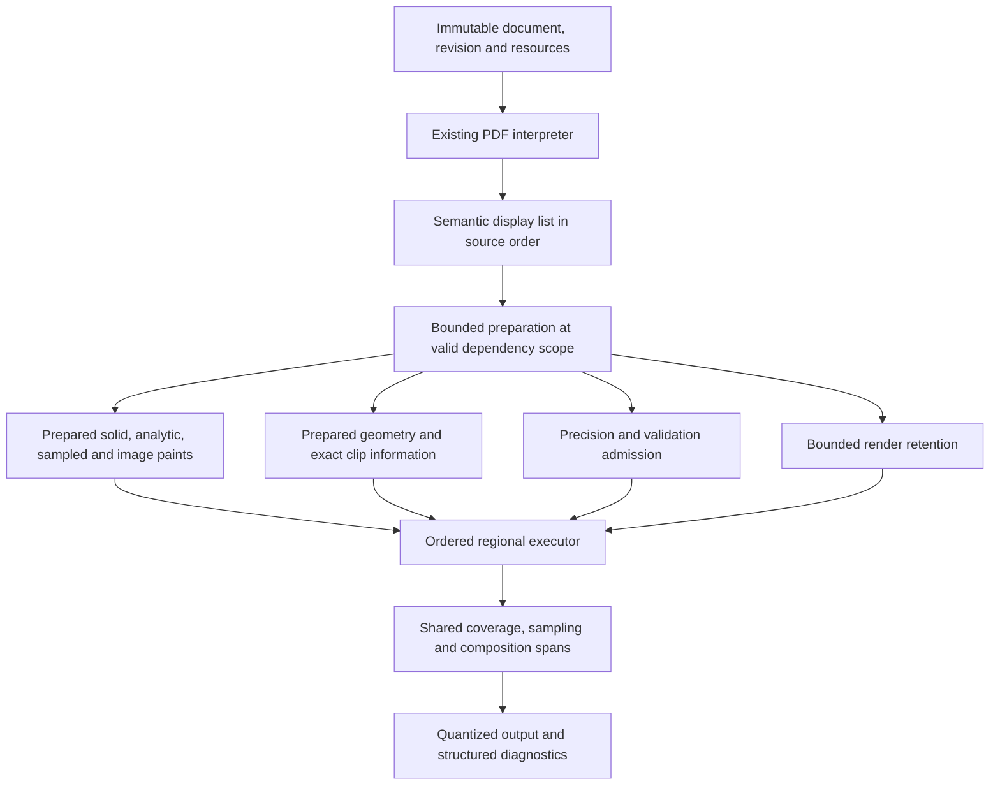

# ADR 0033: Prepared rendering execution and complete session handoff

Status: proposed, 2026-10-21. The user requested preservation and publication
of the session and a detailed architecture handoff. This records the proposed
destination and migration; it does not implement it, grant performance
admission, change an accuracy contract, or authorize a release/main merge.

## Decision in one paragraph

Start a new integration worktree from freshly fetched published main. Preserve
this experimental branch and its evidence unchanged as a historical control.
Selectively transfer independently justified correctness fixes, references and
useful kernels into one coherent rendering execution redesign: PDF semantics
become prepared paints and geometry; an ordered regional executor feeds shared
span kernels with explicit precision admission. Remove superseded execution
routes as their replacements qualify. Public accuracy choices describe policy,
not separately evolving renderers. One implementation program has independently
reviewable milestones; a first-attempt victory over every competitor is not a
credible guarantee.

## 1. Why this decision exists

The objective throughout the session was to outperform competing PDF engines
fairly, with independently stronger accuracy rather than hidden approximation,
while preserving safe Rust, bounded hostile-input behavior, tile independence
and native/WebAssembly consistency. The user explicitly preferred preserving
useful partial gains so they could stack, instead of discarding every change
that failed the complete competitive target in isolation.

Work began with a proposal to unify Exact and Competitive, followed by evidence
and runner infrastructure, measured optimizations, correctness repairs and
integration. A later identical-workload Hayro comparison exposed a large
execution gap, especially on two constant-color shading pages. Source review
and focused profiles showed that the dominant deficiency is repeated generic
paint sampling inside the pixel loop. Local optimization did not adequately
challenge that representation early enough.

The conclusion is neither that the work was worthless nor that a passing unit
suite establishes the goal. There are useful correctness mechanisms, kernels
and reproducible measurements. Full mode unification, competitive admission
and a direct session-start-to-final combined speedup remain unproved. The
target architecture must organize those assets rather than perpetuate every
experimental route.

This ADR replaces the execution priorities of the earlier branch-specific
[unification proposal](0016-unified-renderer.md) and
[implementation plan](../plans/unified-renderer.md). Their detailed invariants
and independent [validation gates](../plans/unified-renderer-validation.md)
remain useful unless explicitly revised. **Numbering conflict:** published
main uses ADR 0016 for domain budgets, not this branch's unification proposal.
When moving documents to main, reference exact paths and reconcile the old
proposal without overwriting main's accepted ADR 0016.

## 2. Source basis and preservation map

| Identity | Meaning |
|---|---|
| `359e19dda5b78a23675678b6a153da7ab7fdc2c5` | Original session/planning product basis |
| `676a872eb9f6c279cbf1e3929ace3a0c99db9fc3` | Available control with the same product/build sources as the starting basis; evidence tooling differs |
| `db957c3233c0bd12540c0c7a401148098ff8ec03` | Preserved `codex/unified-renderer-plan` head |
| `57c8eae7582d50122b4c89a1051c4d53e04f0169` | Preserved `codex/renderer-stacked-gains` head, including earlier measurement/experimental work |
| `d81d0c82612b70934d076e327ca5a154306bf487` | Last main integration shared by current experimental branch and published main at handoff |
| `a9814ee476c1b17a27b1e9a904f1f4fac8d5cd9c` | Experimental reconciliation merge containing that main basis |
| `402e3afe3a08bd178d427ba965883535e75a9dd5` | Measured combined renderer product, before documentation-only comparison publication |
| `02d1083711085cecb5c09fecc10d7adf0239d3bc` | Combined branch before this handoff, including the audited Hayro comparison |
| `ece3e4df02cee5307cacfcbdfdb254ab2bf8c9b1` | Published main inspected during the initial architecture comparison |
| `ad54206b9255ac0152a88120e9490589691503cc` | Published main fetched while preparing this handoff; it has advanced since that comparison |

The active preservation branch is `codex/renderer-n16-interval`. Its handoff
commit is the commit containing this ADR; do not substitute that documentation
commit for a historical product/binary identity. The original planning head
and stacked-gains head are not ancestors of the combined head, so preserving
only the combined branch would lose reachable access to some session history.
They are published separately. The detached starting control is published as
`codex/archive-renderer-baseline`.

The [preservation inventory](../../benchmarks/results/renderer-session-archive.json)
records worktree heads, original dirty/untracked state, archive assets and
hashes. Dirty control files are snapshots, not applied fixes or validated
commits. They are preserved without resetting, staging or modifying those
control worktrees. Historical hashes, failed attempts and parked candidates
are retained rather than rewritten to resemble the final branch.

Raw outputs and logs are too large for ordinary Git history. GitHub draft
release `renderer-session-handoff-2026-10-21` holds evidence archives and their
file inventories. See the
[archive instructions](../../benchmarks/results/sources/renderer-session-handoff/README.md).
Unrelated process-command snapshots and any credential-like material are
excluded from public assets, with original hashes and omission reasons recorded.
Consequently public archives are not asserted to contain every byte needed to
repeat historical raw-receipt audits. Original private evidence stays intact.

### What to keep from each foundation

Published main is the integration base: current document/typed APIs, budgets,
decoders, font infrastructure, host/session work, editing foundations and raster
corrections. This branch is a source of reviewed changes, not a drop-in
replacement. Main now includes domain budgets/Meter, validated geometry APIs,
and ADR 0022's ownership of geometry and byte quantization in pagura-raster.
Do not copy old field names, raw rectangle access or rounding helpers back over
those decisions. Inspect their current migration status before porting.

This branch contributes independently derived composition repairs, references,
evidence bindings and runner controls, glyph-hull reuse, output-conversion
kernels and painted-interval ideas. Transfer each with its proof obligations
and costs. An old baseline defect is not a behavior that must be preserved.
Existing U8, N16, F32 and F64 code must be inventoried by actual callers;
retained legacy code is not evidence that normal planning executes it.

## 3. What happened and what the evidence establishes

| Session work | Result and limitations | Evidence |
|---|---|---|
| Architecture and validation planning | Shared preparation/certified execution proposed; no initial speed claim | Earlier ADR and plans linked above; original plan commit `89d9f30f` |
| Reference/artifact/runner infrastructure | Pinned independent references, retained outputs, source/command receipts, bounded serial checks and failure-aware statistics; helpers are not mathematical or execution attestations by themselves | Commits `f530be92`, `676a872e`; [implementation log](../plans/unified-renderer-progress.md) |
| Clip and glyph preparation | Useful measured partial gains; lazy root glyph-hull memo adds fixed scratch and leaves protected failures open | [glyph experiment](../../benchmarks/results/glyph-memo-experiment.md), [stage analysis](../../benchmarks/results/glyph-memo-stage-analysis.md) |
| Composition repair/unification | Corrected real independent failures in opaque accumulation, premultiplied nonopaque backgrounds and Competitive translucent text; increased some work/storage | [opaque contract](../plans/opaque-composition-accuracy.md), [composition report](../../benchmarks/results/opaque-composition-experiment.md), [precision preservation](../../benchmarks/results/f32-preservation-cost.md) |
| N16 output and painted intervals | Retained exact conversion and sparse-output gains; individual experiments have different baselines and must not be multiplied | [N16 conversion](../../benchmarks/results/n16-output-u16-experiment.md), [N16 interval](../../benchmarks/results/n16-painted-interval-experiment.md) |
| Rectangle reservation | Useful primary medians, but parked after valid compound paths retained more capacity; full patch preserved | [experiment and candidate patch](../../benchmarks/results/rectangle-reserve-experiment.md) |
| Main reconciliation | Restored upstream image-sampling order and JPEG invariant; preserved measured historical identities; no new speed claim | [reconciliation](../../benchmarks/results/main-reconciliation.md) |
| F32 painted intervals | Sparse target medians improved 50.0% Exact and 55.1% Competitive versus its N16-interval baseline; full admission still failed | [latest experiment](../../benchmarks/results/f32-painted-interval-continuation-experiment.md) |
| Fixed-stack Hayro comparison | Complete audited 39-page, two-mode comparison; strongest current cross-engine evidence, not a global ranking | [comparison](../../benchmarks/results/current-stack-hayro.md) |
| Shading investigation | Three short warm-context profiles plus source/layout analysis; identified repeated sampling overhead, not a new performance improvement | [profile report](../../benchmarks/results/shading-architecture-investigation.md) |

Latest F32 interval admission: protected latency 17/54 pass; sampled maximum
RSS 30/56 pass. Exact sparse-target peak RSS grew 6.6%. Two controls have
positive regression evidence under the declared 2% material threshold.
Historical full serial validation passed, including 1,249 conformance cases,
native/WASM and host checks. These results apply to the frozen revisions in
the reports; they are not validation of the proposed replacement or latest main.

The direct session-start versus final-stack comparison is still missing.
[Its plan](../plans/start-to-current-measurement.md) is preserved. No defensible
single cumulative speedup percentage or calendar date of world leadership was
established. Earlier session-start reports and operation-specific comparisons
must be read with their exact settings and source scope.

### Fixed combined stack versus Hayro

Pagura product source SHA-256:
`4d6f7ab3f68500009aa938b1e3680d8c26a6fc052f706dd3a4ce5ad697b94a8e`.
Hayro 0.8.0 is a standalone public-API adapter with its lockfile pinned.
The fresh Pagura binary SHA-256 was
`e8013da445f4a2d5e45d3629a95403e11feb1ddb4428b2ced7954864b934b057`;
Hayro adapter binary SHA-256 was
`479a9afcdd62fd3b70dfebfc140ade495e279c6100a24588c7035b42272978e1`.

There were 39 analytic single-page PDFs, both modes, 100 measured pairs and
five warmups per cell: 78 cells, 8,190 pairs, 16,380 output attempts. Every
warmup and measured frame contributes to correctness. Inputs/settings were
identical, 72 DPI/page zero/white, fresh process. Primary time is open plus
render, including preparation. Output emission and whole-process wall time are
separate. RSS is the process high-water value including emission, not a live
renderer-heap measure. The common independent RGB-over-white policy is strict
zero tolerance. This does not establish independent cross-engine alpha superiority.

| Panel | Mode | Pagura correct | Hayro correct | Both correct | Median of case median time ratios, Pagura/Hayro |
|---|---|---:|---:|---:|---:|
| Legacy 19 | Exact | 19/19 | 13/19 | 13 | 1.1543 |
| Legacy 19 | Competitive | 18/19 | 13/19 | 13 | 1.1842 |
| Interval 20 | Exact | 20/20 | 20/20 | 20 | 2.0216 |
| Interval 20 | Competitive | 20/20 | 20/20 | 20 | 1.6447 |

Exact matches 39/39, Competitive 38/39, Hayro 33/39 under that finite policy.
Competitive's fractional RGB image differs in 64 channel values by one level
on every attempt. Do not silently repair it during historical reproduction.
Policy disagreements are not alone PDF-standard violations. Wrong-output
timings stay visible but cannot support accuracy-qualified speed claims.
There is no qualified cell meeting the 20% median-and-p95 upper-bound target.
The single Competitive opaque median win is about 6.3%, with worse process
time and memory. Across the 33 mutually correct cells per mode, 24 have sampled
maximum RSS above Hayro. No universal superiority follows from this panel.

### Why shading changed the architecture priority

Both 512-square fixtures are constant black Type 2 axial functions, equal
endpoints, exponent one, opacity one quarter over white. Their independent
expected RGB byte is 191 everywhere. They do not represent all shading types.
Pagura spends about 19--22 ms rendering versus Hayro's 0.31--0.32 ms. Open is
about 0.05 ms. Open-plus-render ratios are 54--63; whole-process ratios are
about 4.5--5.2. Do not conflate those metrics.

Pagura performs 262,144 function/sample evaluations, with generic color/source
construction, coordinate handling and composition. Type 2 writes into a caller
buffer: there is no per-pixel Vec allocation here. Three serial profiles locate
about 74--82% of samples in sampler self-work, functions and color/source setup;
pow alone is only about 5--6%. Removing exponentiation alone cannot close the
gap. As an Amdahl-style indication, the sampled shares suggest preparation
alone is unlikely to close it; span execution must also be investigated. This
is not a measured lower bound: warm instrumented shares cannot be multiplied
into cold competitor timings as if residual work were fixed.

Hayro prepares supported axial/radial paint as a backend gradient. These constant
functions need five preparation samples. Vello then uses a compact ramp and
SIMD rasterization; source inspection did not identify equal stops collapsing
to a solid. The measured adapter enables the single-threaded U8 backend.
General gradient conversion uses tolerance 0.01; that is not our Exact proof.
The source reasoning is not a sampled Hayro function-cost attribution.

Memory has a partly independent cause. Direct shading uses F32 in both modes;
Exact shading patterns use F64, Competitive patterns F32. With one live 256-square
chunk, F32's surface is 1 MiB, F64's seven-double Pixel surface 3.5 MiB. Add a
1 MiB output and 64 KiB coverage mask: approximately 2.0625 versus 4.5625 MiB
large live payload. Emission and allocator retention are separate. The worst
Exact pattern sampled RSS ratio, 4.82, is 19.42/4.03 MiB maxima; typical median
peak RSS is 7.13/3.92 MiB, about 1.82. Payload layout does not explain every
extreme process peak. Dense pages receive no benefit from skipping untouched
output conversion.

## 4. Architecture assessment and options

For this CPU/WASM rendering objective, Hayro/Vello is currently the stronger
execution foundation than either our current experimental execution or main's
corresponding machinery. This is a reasoned architecture assessment supported
by inspected paths and measured workloads, not a universal ranking of entire
PDF products. Applying that recommendation to WASM and freshly advanced main
is an unmeasured inference: there is no equivalent Hayro WASM comparison or
head-to-head result against today's main. M0 must validate those foundations.
MuPDF, PDFium and PDF.js also prepare graphics work outside pixel
loops. No complete cross-engine architecture audit or equal-scope code census
was performed.

Hayro's rendering integration is only about 1,500 Rust code lines, but its
syntax/interpreter total about 36,700 and Vello CPU/common another 21,400:
about 59,700 combined, before additional codecs, fonts, geometry, color and SIMD
dependencies. Additional Hayro codec/CMap/PostScript crates add about 18,200.
This branch has about 50,800 renderer+raster code lines and 134,600 across all
crate src directories. Counts exclude blank/comment lines but include inline
tests, conditional implementations and tables. They are not equivalent feature,
compiled-size or runtime-complexity comparisons. Hayro's small integration
does not mean a trivial backend or absence of specialized paths.

Vello organizes solids, gradients, images, default/general blending, opaque
overwrite, masked composition and image samplers under common interfaces and
numeric kernels. Architectural generalization and specialization cooperate:
select a specialized loop outside the hot loop instead of repeatedly branching
over PDF semantics inside it. We need independently designed equivalents of
that principle, not copied code or mirrored implementation structure (ADR 0006).

| Option | Benefit | Cost/risk | Decision |
|---|---|---|---|
| Keep extending this experimental branch | Immediate access to all kernels and historical measurements | Stale integration basis, experimental costs and duplicated routes can dictate the destination | Preserve as control, not new integration base |
| Resume isolated optimizations on main | Small reviews and easy local attribution | Does not by itself remove the central representation/execution deficiency | Use only within the agreed redesign |
| New coherent execution layer on current main | Current foundations plus shared preparation, bounded execution and explicit precision | Significant design, migration and independent-validation effort | Proposed |
| Replace the complete PDF stack or adopt another engine | Could reuse mature infrastructure | Loses substantial validated work; conflicts with independence/dependency/safety constraints | Reject for this program |

The process correction is to benchmark the complete system and challenge its
representation before accumulating more micro-optimizations. Preserving partial
wins was deliberate; describing them as completed competitive progress would
be incorrect. Preparation, execution and precision are measured independently
to identify causes, even when implemented within the same program.

## 5. Target architecture

### Semantic list and prepared operations

Keep the existing semantic display list authoritative for PDF source order,
resource identities, group boundaries and diagnostics. Add private concrete
execution types in pagura-render; do not introduce a public PreparedPage API,
plugin system, generic graph compiler or new crate merely for this migration.

Preparation lowers repeated decisions into immutable data. Proposed paint
variants represent independently certified constant/solid, analytic affine,
general evaluated shading and prepared image sampling. Variants are chosen by
mathematical capabilities, not file names, benchmark identities or function-type
labels alone. Direct sh and PatternType2 attach their placement/coverage to the
same prepared paint semantics. Generic shading remains a paint evaluator
inside the common executor, not a second complete renderer.

Compile preparation at the narrowest scope its dependencies permit: document
function facts, page resources, render color intent, group backdrop/model,
device transform, or command-local state. A prepared color cannot cross a
changed color/transfer/overprint context. Retain original identities/owners so
pointer reuse cannot alias cache entries. Include actual policy, transform and
validation provenance in keys; an Accuracy enum alone is insufficient.

### Geometry, coverage and scheduling

Geometry remains PDF-agnostic in pagura-raster, following current main's ADR
0022. The renderer adapts PDF clip/group semantics to that geometry. Reuse
geometric full/outside information and clip boundary data; multiplying marginal
coverage masks is not exact intersection. Resolve doubly fractional boundaries
jointly. Keep glyph placement, winding, point/ghost rules, source order and
knockout semantics. Do not union independently composited glyph instances.

The regional executor uses conservative incidence and original order. Unknown
bounds and commands whose omission could change validation, repairs, limits or
errors remain broadcast/general. Small/dense pages can skip index construction
and use the same ordered executor. No index can eagerly decode unused resources
or change the established traversal's first observable failure. The current
64-entry root-hull memo
is an asset to assess, not an implemented scene schedule.

Global device coordinates anchor all sampling and precision admission. A tile
cannot change sample phase, dependency classification or output rounding. Group
boundaries, masks, transfer and special inks remain explicit dependencies.

Before changing region boundaries, M0 must freeze the authoritative traversal
and failure contract against current main. Current execution is region-major;
preserving command order inside each region does not preserve the global first
failure, repeated command charges, exhaustion point or partial pixels when
regions change. Add competing failures in different regions, tiny work budgets
and partial-write references. Preserve that behavior or propose an explicit,
separately reviewed policy migration; do not assert source-order equivalence
from a per-region ordering check. Scratch-layout changes must satisfy the same
contract even when final successful pixels are identical.

### Precision and numerical contract

Select precision for a proven dependency scope before its first store. Start
with conservative page/group admission; introduce region admission only where
the downstream bound is established. Solids, gradients, text and images use the
same composition arithmetic for the same admitted state. Preserve full source
opacity; do not quantize marks early just because final output is a byte.

ADR 0004 defines stage-specific references, including quantized coverage for
composition and documented f64 behavior for amplifying operations. Exact does
not mean perfect continuous-scene integration or arbitrary-precision PDF
arithmetic. Independent rational and true-curve references remain authoritative
for their declared classes. A new continuous/filtering model is a separate
accuracy decision, not hidden inside this performance migration.

Bounded error analysis should usually happen per operation/group/block; avoid
expensive per-pixel interval machinery unless measured savings pay for it.
Promoting already rounded bytes cannot recover lost precision. If admission
cannot be decided before mutation, retain original inputs and a separately
bounded transactional scratch result for replay, or decline the specialization.
Replay must not double-paint, reset work, duplicate diagnostics or occur
without a bound. It is a later capability, not a first-stage requirement.

Native/WASM arithmetic must meet both applicable independent error bounds and
declared identity gates. SIMD, FMA, changed summation order and incremental
coordinate stepping each need evidence. Safe Rust and the no-new-product-
dependency constraint remain. Better loop layout and compiler vectorization
are available without adopting a competitor's unsafe-backed SIMD dependency.

### Limits, validation, failure order and memory

Use current main's domain budgets and Meter ownership; do not import historical
overloaded Limits meanings. Account for output, live scratch, caches, vector
capacities, indexes and temporary overlap in the applicable render ledger.
Document retention, per-render work and session-wide host budgets remain
separate. Optional preparation has bounded time/storage, is attempted once per
scope, and may decline without consuming the mandatory fallback allowance.
Any aggregate-budget policy change needs its own review and reference cases.

A mathematically constant function can still fail on invalid input arithmetic;
equal endpoints alone are not a certificate. Suppressing evaluation can change
observable work and partial failure. Preserve the existing
`late_function_failure_keeps_full_range_partial_pixels_and_charges` behavior.
Bulk logical charges are permitted only if success and failure prefixes are
proved equivalent; otherwise retain ordered checks/general execution. Cache
hits, eviction and optional refusal cannot suppress required validation.

Reuse bounded working buffers while clearing state correctly. Tune scratch
shape independently of public tiles; four-row byte bands are inspiration, not
a mandatory layout. Wider arithmetic can remain efficient with compact working
sets. Keep emission/PPM staging out of engine-only speed attribution. Host and
direct rendering should share preparation ownership rather than gain another
page cache.

## 6. Opportunities to exceed competitors

These are testable hypotheses, not established wins or promises of universal
dominance:

1. Certify constant paints and execute them as solid spans rather than a
   generic evaluator or unnecessarily sampled ramp. Preserve geometry/extend,
   color, alpha, work and failure semantics.
2. Reuse exactly identical shading samples. An eligible horizontal gradient
   can have only one distinct sample per column across many rows. Admission
   must prove actual coordinate and state equivalence; do not approximate a
   general two-dimensional field by a one-dimensional cache.
3. Use analytic constant/affine function evaluators and finite-input tables
   where exact/bounded output is proved. General adaptive ramps need error
   enclosures through color and composition, plus fallback near discontinuities
   and quantization boundaries. Hayro's tolerance is not an Exact certificate.
4. Combine exact clip/curve reuse with work proportional to relevant geometry,
   rather than trading coverage fidelity for reuse. Retain true-curve oracles
   for admitted curve kernels.
5. Make direct and retained image execution honor the requested region while
   preserving full source sampling semantics. Full entropy decoding remains
   initially; lazy coefficient/sample reconstruction is separate research.
6. Use admission to spend high precision where needed and compact arithmetic
   elsewhere. Count analysis cost and failure rates, rather than assuming
   adaptive precision is automatically faster.
7. Organize contiguous span loops and fixed prepared state so safe portable
   code can vectorize. Preserve painter order while processing independent
   pixels together; never claim compiler vectorization without inspecting or
   measuring it on each target.

The first constant-gradient proof is intentionally narrow. General preparation
and common execution must then demonstrate reach on nonconstant gradients,
ordinary fills/text, mixed images and groups. A separate subsystem for every
fixture is a rejection signal.

## 7. One migration program, independently testable milestones

This is a single destination architecture, not a requirement for one enormous
unreviewable commit or one benchmark attempt. Independent source work can be
parallel; only one coordinator launches local compute. Keep old/new execution
available for differential investigation during migration. The final public
implementation should have one shared executor and a bounded general evaluator,
with obsolete routes removed after equivalent coverage is established.

| Milestone | Concrete deliverable | Exit evidence / deletion obligation |
|---|---|---|
| M0: reconcile | Fresh main worktree, exact baseline identities, port matrix; carry independent corrections and define region-major traversal/failure/charge contract before changing regions | Current main check; independent references and cross-region failure/partial-write cases; no old API/budget/quantizer reintroduction |
| M1: prepare | Private prepared-paint/geometry/state types with correct scope, bounded construction and shared direct/pattern shading admission | Constant and varying gradient references; tiny-page construction cost; required error/work parity; no duplicate paint semantics |
| M2: execute | Common ordered span executor; constant/analytic kernels; general evaluator behind same interface | End-to-end shading and mixed-page gains, cold included; remove replaced per-route loops when covered |
| M3: schedule and store | Bounded region selection and scratch reuse; conservative precision admission shared across primitive types | Full-page/irregular-tile equivalence, sparse/dense/knockout/clip controls; actual retained and peak memory |
| M4: share image/text preparation | Requested-region images, retained/direct ownership reconciliation, prepared glyph/clip reuse where proven | Cold/warm and first-tile/full traversal, image/curve references, cache/validation permutations; remove redundant caches |
| M5: prove and simplify | Held-out real-document and analytic matrix; native/WASM; remove migrated legacy paths and document remaining fallback | Independent accuracy, competitor median/p95/RSS gates, source/code-size and maintenance-cost review |

Dependencies are semantic, not a ban on drafting M2/M3 together after interfaces
are settled. Measure preparation, execution and precision changes separately
enough to identify causality. Partial wins can remain experimental while gates
are open; they cannot quietly become the default or erase a supported regression.

## 8. Independent accuracy and benchmark gates

Carry A0--A5 and T0 from the earlier validation plan, adapting implementation
paths without relaxing their contracts:

- Independent expectations from declared rational/analytic, true-curve or
  reviewed semantic references. Existing Exact output and majority agreement
  are differential evidence, not universal truth.
- Explicit source/settings/reference hashes and executed commands, plus every
  distinct output's actual pixels. Include RGB, alpha and nonwhite/transparent
  backdrop behavior where the claim needs them. Do not infer alpha from PPM.
- Constant and nonconstant Type 2 functions, other function classes, power/domain
  edge cases, range clipping, Extend/BBox/background, transforms, radial
  degeneracy, antialiasing, ICC, masks, transfer, overprint and groups as admitted.
- Near-byte boundaries, long partial-overlap chains, knockout, repeated samples,
  late failures and tiny limits. A corrected defect receives a new independent
  expectation and rebaseline, never a silent tolerance increase.
- Full/irregular tiles, request order, cache hit/miss/eviction/refusal,
  native/WASI SIMD and scalar. Scalar builds explicitly disable simd128.
- Hostile inputs retain bounded work/memory, error kind/object/position and
  required partial-write behavior. A faster unsupported/error path is not a win.

Benchmark all of the following, with one frozen workload and comparison policy:

| Dimension | Required measurement |
|---|---|
| Cold single page | Open, compile/preparation, geometry/coverage, sampling/color, composition, output conversion; avoid double-counting nested timers |
| Persistent document | Open once; all pages; cache population/retained bytes; document total and per-page first/repeated timings |
| Viewport | First tile, irregular tiles, full tiled traversal; same global coordinates and output as full page |
| Memory | Process peak RSS, renderer live/retained capacity ledger, transient overlap, warmed cache pressure; report them separately |
| Competitors | Pinned versions/build flags, equivalent settings/output policy, both successes and failures, identical workloads |
| Coverage | Original analytic/protected cells plus varying shaders, fills, text, images, clipping, transparency and untouched real-document holdout |

Use a dedicated runner if available; locally acquire both cooperative locks,
scan for foreign compute and run serially. Do not kill or signal foreign work.
Honor user instructions about preserving interrupted measurements; preserve
original attempts and method amendments. A lock/observer is not OS exclusivity.
Freeze trials and statistics before looking at outcomes; no repeated sampling
until a favorable run appears. Marginal one-sided bootstrap bounds are not a
family-wide or temporal-dependence guarantee.

Full competitive target: median and p95 one-sided 95% upper time ratios at most
0.80 against each applicable required competitor, independently qualified
accuracy, and no greater sampled peak memory under the declared policy. Keep
the broader existing release matrix; do not shrink it to Hayro or this 39-page
panel. Absolute peak/hostile-input bounds remain independently required.

For useful internal slices, predeclare the workload, meaningful gain threshold,
protected controls and resource bounds using the existing P1 policy. Report
point estimates, bounds, misses and supported regressions separately. Preserve
useful partial wins without promoting them. The current shading stretch target
is about 0.28 ms open+render against the measured ~0.35 ms Hayro cells, implying
roughly 98.5--98.7% less engine time than today's 19--22 ms; it is an aspiration,
not a demonstrated consequence of caching one function.

## 9. Reject, retain experimentally, or admit

Reject or redesign an idea when it:

- Violates an independent bound, changes required failure/resource semantics,
  loses tile/native/WASM consistency, suppresses unsupported behavior, or needs
  a fixture-name exception, hidden approximation, unsafe code or copied source.
- Saves a microkernel but loses the gain after cold preparation, output,
  document lifetime or memory accounting.
- Adds a second semantic implementation/cache or broad framework without
  measured reuse, or leaves old and new route combinations without owners and
  explicit retirement criteria.
- Depends on larger retained capacities/replay than its declared envelope,
  moves work outside the timer, or compares wrong-output speed as qualified.
- Helps only the constant fixtures without showing its claimed general reach.

Retain experimentally if accuracy is independently sound and a useful partial
gain is demonstrated, while publishing incomplete gates and supported
regressions. Admission requires all declared gates. Record added/deleted code,
alternatives, maintenance cost, applicability and fallback frequency. No
promised completion date or universal perfection claim follows from a finite
test matrix.

## 10. Resume in a new session

First read this ADR, the [latest status](../plans/unified-renderer-status.md),
the [implementation history](../plans/unified-renderer-progress.md), the
[Hayro report](../../benchmarks/results/current-stack-hayro.md), and the
[shading investigation](../../benchmarks/results/shading-architecture-investigation.md).
The archive README explains GitHub assets and restoring historical raw evidence.

The handoff operation only publishes documents, history and evidence. Renderer
optimization remains paused here. A new user request to implement this ADR
should begin with M0; do not silently restart the old next-micro-optimization
queue or mark the standing fastest/most-accurate goal achieved.

Suggested starting prompt:

> Read ADR 0033 from codex/renderer-n16-interval and its linked evidence. Start
> the proposed prepared-renderer migration on a fresh worktree from current
> published main. Preserve the archived branch as control, reconcile main's
> current contracts, carry independently justified fixes and references, and
> implement one shared execution architecture with independently testable
> milestones. Do not weaken accuracy/resource gates or add product dependencies.
> Only the coordinator may run local compute; no contention with other jobs.
> Report measured whole-workload gains and memory, preserve useful partial wins,
> remove superseded routes, and do not claim universal leadership from a subset.

Fetch the preservation branches before inspecting them. Use worktrees rather
than resetting any current checkout. Re-fetch main and inspect its changes
since the pin above. Rebuild binaries for a new comparison and bind their
hashes; old /private/tmp binaries and absolute paths in historical receipts are
not portable execution instructions. Restore evidence for inspection, but
create a new frozen manifest if paths/settings must change for a rerun.

## 11. Source-study provenance

All product work remains independently designed. These sources informed ideas
and comparisons; no competitor implementation is included in this handoff:

- Hayro 0.8.0: paint preparation and Type 2/gradient interpretation, installed
  by the pinned [adapter lockfile](../../benchmarks/adapters/hayro/Cargo.lock).
  Relevant files: hayro/src/paint.rs; hayro-interpret/src/gradient.rs and
  function/type2.rs; vello_common/src/encode.rs; vello_cpu/src/fine/mod.rs and
  fine/lowp/gradient.rs. Use versions 0.8.0 and 0.3.0, not unspecified latest.
- [PDFium shading preparation](https://pdfium.googlesource.com/pdfium/+/refs/heads/main/core/fpdfapi/render/cpdf_rendershading.cpp): prepared 256-entry color table before axial painting.
- [MuPDF display list](https://github.com/ArtifexSoftware/mupdf/blob/master/source/fitz/list-device.c), [paint](https://github.com/ArtifexSoftware/mupdf/blob/master/source/fitz/draw-paint.c) and [shading](https://github.com/ArtifexSoftware/mupdf/blob/master/source/fitz/draw-mesh.c): shared display execution, specialized spans and interpolation/color-order constraints.
- [PDF.js shading](https://github.com/mozilla/pdf.js/blob/master/src/core/pattern.js) and [Canvas adapter](https://github.com/mozilla/pdf.js/blob/master/src/display/pattern_helper.js): prepared shading representation and graphics-backend delegation.

Non-Hayro links are moving upstream references inspected on 2026-10-21, not
pinned benchmark engine versions. Qualitative study is not a new cross-engine
performance result. No full source census of those other engines was made.
