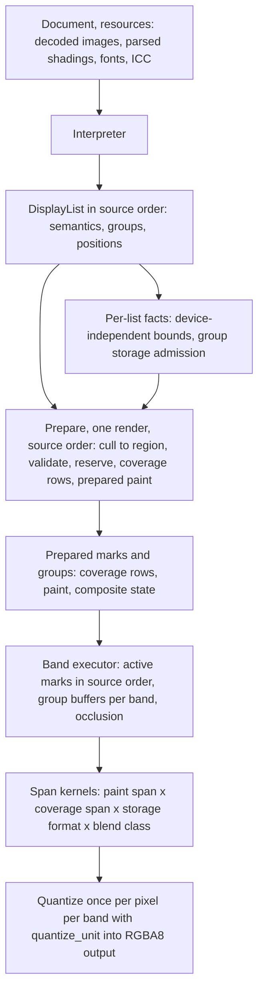

# ADR 0033 challenge: renderer architecture assessment

Status: assessment, 2026-10-21. Documentation only. It changes no renderer or
product code, grants no performance admission, changes no accuracy contract
and claims no competitive superiority for any proposed architecture.

ADR 0033 ("Prepared rendering execution and complete session handoff") was
written on the preserved branch `codex/renderer-n16-interval`. It proposes a
prepared-paint, ordered-regional-executor redesign on current main with
selected experimental assets. This document tests that proposal against the
code on current main, real-document benchmark results, a focused diagnostic,
the experimental branch's product changes and primary competitor sources. It
then recommends a target architecture, a foundation, gates, a migration plan
with retirements, rejection criteria and amendments to ADR 0033.

## 0. Verdict

**Recommend a refined architecture, not ADR 0033 as written.** ADR 0033's
destination principle holds up: decide PDF semantics once, outside pixel
loops, and run one ordered executor over shared span kernels with policy
expressed as kernel admission. Its evidence base, priorities, failure
contract, preparation scopes, gate design and port inventory do not hold up:

1. **Wrong priority signal.** The shading priority came from two synthetic
   constant-gradient pages measured against Hayro alone. On the real-document
   runner track for main, shadings occur in 3 of 25 benchmarked documents.
   The worst real vector page spends about two thirds of its samples in exact
   coverage generation (edge sweep, row edges, edge sorting), not in paint
   evaluation or scheduling. Paint preparation is the second lever, and it
   must be general, because main spends the same 21–22 ms on a varying
   gradient as on a constant one.
2. **The raster-to-compositor interface is the missing component.** Main
   builds a dense mask per mark (and per region on the chunked routes), but
   corpus instrumentation shows touched cells are 2.2% of dense mask width.
   The refined architecture makes sparse coverage rows the single product of
   every coverage backend and the single input of every composition kernel.
3. **Several ADR 0033 facts are wrong for main.** Render does not use
   `Meter` or the domain budgets of ADR 0016; Competitive stores shadings in
   U8, not F32; the late-function partial-pixel test and the 64-entry
   glyph-hull memo exist only on the experimental branch; main never returns
   a partial page; only the host caches compiled pages.
4. **Make execution infallible after preparation.** Rather than freeze
   region-major failure order (which already depends on the requested tile
   on main), validate and reserve every budget in source order during
   preparation and run an executor that cannot fail. Failure order then
   becomes independent of bands, chunks, caches and scheduling by
   construction.
5. **Fewer scopes and caches.** Two preparation scopes (document resources and
   one render), plus the host's existing retained display lists. No
   intermediate caches until measurement requires one.
6. **Lighter, scoreboard-based gates.** ADR 0033 inherits a per-change policy
   (one-sided 95% bounds on every target and protected cell, 2% protected
   guard) that admitted nothing in the experimental session (17/54 protected
   latency cells passed). Keep accuracy gates strict and deterministic; judge
   milestones on the round-5 real-document track plus a small stress set;
   keep ADR 0002's statistical gate for release claims.
7. **Port almost no experimental product code.** Main had moved 141 commits
   past the fork by `ad54206b`, and the experimental compositor work targets
   routes the refined plan retires. Port tests, independent oracles and the
   specific fixes whose defects still exist on main; keep the branch as a
   control.

The refined plan starts with contracts (M0) and two cheap, decisive,
byte-identical experiments on main (E1, coverage rows on the worst vector
pages; E2, a general prepared gradient paint) before any executor rewrite.
The executor consolidation follows, and it deletes routes as it lands.

## 1. Revisions and sources inspected

| Identity | Meaning |
|---|---|
| `ad54206b9255ac0152a88120e9490589691503cc` | Published `main` when this review started. Code statements and the diagnostic were verified on it. |
| `2511a28b3752ba22ae8ccb81c6e9b3da726c171f` | Published `main` when this review was committed: `land/batch-2026-10-21` (`5fbe9e76`) landed as 56 rebased commits with identical content, bringing `pagura-color` (ADR 0028), font budgets (ADR 0023), the page-text crate (ADR 0025) and render clean-ups (53 render/raster files, +841/−2,228). The statements of §3.1 were re-checked on it; the one change is noted there. |
| `e720d351`, `7ac8a8f2`, `f11f9dd8` | `review/pagura-render`, `review/pagura-render-compositor`, `review/pagura-render-session`: in-flight render reviews (memory guards, `function_work` charging, compilation sessions). The last two are 156 commits behind main. |
| `ae734a2b15f5ea0f886a20dd79273580fdc1306d` | `codex/renderer-n16-interval` handoff commit containing ADR 0033 (documents and evidence only). |
| `402e3afe3a08bd178d427ba965883535e75a9dd5` | Measured combined experimental product. |
| `a9814ee476c1b17a27b1e9a904f1f4fac8d5cd9c` | Experimental reconciliation merge with the main basis. |
| `d81d0c82612b70934d076e327ca5a154306bf487` | Last main commit shared by the experimental branch and main; the commit that landed `Accuracy::Competitive`. |
| `db957c3233c0bd12540c0c7a401148098ff8ec03` | `codex/unified-renderer-plan` head (archived ADR 0016 "unified renderer" proposal and plans). |
| `57c8eae7582d50122b4c89a1051c4d53e04f0169` | `codex/renderer-stacked-gains` head. |
| `676a872eb9f6c279cbf1e3929ace3a0c99db9fc3` | `codex/archive-renderer-baseline` starting control. |
| Draft release `renderer-session-handoff-2026-10-21` | Asset list inspected (15 assets, two raw archives of 108 MB and 194 MB). Not downloaded: the committed summaries answered every question this review needed. |

Competitor sources, read for ideas and behaviour only (ADR 0006): hayro
0.8.0, hayro-interpret 0.8.0, vello_cpu and vello_common 0.3.0 and
fearless_simd 0.7.0 from the pinned cargo registry; PDFium chromium/8076 and
MuPDF 1.28.2 from the hashed local reference copies that match the benchmarked
binaries; pdf.js from moving upstream `master` (not a pinned benchmark
version). No competitor code is reproduced here.

Documents read on the experimental branch: ADR 0033; the archived ADR 0016
"unified renderer" proposal; `docs/plans/unified-renderer{,-status,-progress,-validation}.md`;
`opaque-composition-accuracy.md`; and the result reports
`current-stack-hayro`, `shading-architecture-investigation`,
`f32-painted-interval-continuation-experiment`, `n16-painted-interval-experiment`,
`n16-output-u16-experiment`, `opaque-composition-experiment`,
`f32-preservation-cost`, `glyph-memo-experiment`, `rectangle-reserve-experiment`
and `main-reconciliation`. On main: ADRs 0002, 0004 (with all amendments),
0006, 0012, 0016, 0017, 0022 and 0032, and `docs/ARCHITECTURE.md`.

## 2. Evidence base

### 2.1 What ADR 0033 rests on

ADR 0033's comparative evidence is one fixed product (`402e3afe`) against
Hayro 0.8.0 alone, on 39 synthetic analytic single-page PDFs at 72 dpi, cold
process, open plus render. It is carefully audited and honest about scope.
Its decisive observation is two constant black Type 2 shadings at opacity 1/4,
where Pagura spends 19–22 ms and Hayro about 0.31 ms (54–63× engine time,
4.5–5.2× whole process). The other cases range from 0.94× to 12.4× (image-only
11.7–12.4×, default knockout 6.0–6.7×), with median case ratios of 1.15–2.02
per panel and mode. The panel contains no real document, no 150 or 300 dpi
cell, no PDFium, MuPDF or pdf.js, and no WebAssembly run.

### 2.2 Real documents on main

The accepted ADR 0004 gate is defined on the round-5 real-document suite (25
documents, 100 page/DPI cases, 72/150/300 dpi) against the best of PDFium,
MuPDF and Hayro per cell. The runner results for `d81d0c82` (both modes,
x86-64 and Graviton metal, one run each on 2026-10-21, ten samples, retained
outside the repository) give, as the median per category of Pagura render
time divided by the fastest competitor's render time for that page. Render and
raster changes from `d81d0c82` to `ad54206b` are API, naming and accounting
clean-ups (27 commits, +1,470/−672 lines), and §2.3 confirms the outliers on
`ad54206b`.

| Category | DPI | x86 Exact | x86 Competitive (worst page) | Graviton Exact | Graviton Competitive (worst page) |
|---|---:|---:|---|---:|---|
| Text | 72 / 150 / 300 | 4.6 / 4.7 / 3.7 | 1.10 / 0.94 / 0.98 (1.48) | 3.5 / 3.5 / 3.2 | 1.01 / 0.84 / 1.03 (1.22) |
| Vector | 72 / 150 / 300 | 2.8 / 3.3 / 5.8 | 1.51 / 1.36 / 1.16 (5.49) | 2.6 / 3.1 / 3.8 | 1.36 / 1.22 / 1.06 (3.59) |
| Mixed | 72 / 150 / 300 | 4.1 / 4.5 / 5.5 | 1.66 / 1.28 / 1.72 (2.85) | 4.5 / 4.9 / 7.8 | 1.34 / 1.20 / 1.56 (5.02) |
| Images | 72 / 150 / 300 | 3.0 / 2.6 / 1.3 | 1.00 / 0.81 / 0.79 (2.20) | 2.7 / 1.8 / 1.2 | 1.00 / 0.77 / 0.85 (1.96) |

These are exploratory ratios of medians from an uncontrolled runner, not
release evidence. They are, however, the only cross-engine evidence on real
documents for the code this plan would change, and they reorder priorities:

- **Exact is 1.2–7.8× the best competitor in every category.** Competitive
  is near the absolute goals for text and images and far from them on a few
  vector and mixed pages.
- **The worst pages are vector and mixed:** `0000638` page 0 (vector, 5.5×
  Hayro on x86 at 72 dpi), `0000301` page 1 and `0000418` page 1 (mixed,
  2.2–2.9×), and the large-JPEG image pages at 72 dpi (`0000603`, 2.2× MuPDF).
- **Shading is rare in the suite.** A dictionary scan of the 25 benchmarked
  documents finds `/ShadingType` in three (`0000098`, `0000418`, `0000646`);
  `0000418` has 17 axial shadings, all with sampled (Type 0) functions and
  drawn as shading-pattern fills beside 34 images (17 with image soft masks),
  and is one of the worst mixed pages.
- **Peak process memory against Hayro** (the only competitor whose adapter is
  also a native Rust process; PDFium and MuPDF run under Python) has median
  ratios of 1.1–1.4 at 72 dpi and 1.7–2.2 at 150 and 300 dpi, in both modes.
  The cause is not attributed (§3.4).

### 2.3 Focused diagnostic on main

One question could change the plan's first milestone: on current main, where
does time go on the worst real pages, and does main still show the shading
gap? This review ran one serial diagnostic, Pagura only, under the repository's
cooperative bench locks (`/tmp/pagura-bench.lockdir` and `/tmp/pagura-bench.lock`),
after a foreign timing job had finished, with no other Pagura, cargo or
competitor process running. Machine: Apple M3 Pro, macOS 15.6.1, rustc 1.99.1,
release profile of main (`lto = "thin"`, `codegen-units = 1`,
`overflow-checks = true`), CLI binary SHA-256
`565b099fafd2b83fc7f3b8a86e20da9aa92929e1ba88fd7ae70d0cfe75fd1b63`. The
desktop was busy (load average 5–10), so times are indicative only; profile
shares are the point. Each case ran `pagura microbench --accuracy MODE INPUT
render-warm N DPI` three times (median shown), then a three-second
`sample` of a longer run. Inputs: the two ADR 0033 fixtures regenerated from
their published generator, the same fixtures with `C1 [1 0 0]` (a varying
gradient), `0000638.pdf`, and pages 1 of `0000301` and `0000418` extracted as
single-page files.

| Input | DPI | Exact ms | Competitive ms | Dominant samples |
|---|---:|---:|---:|---|
| constant `sh` | 72 | 21.5 | 21.6 | Exact: `shading_sample` 37%, per-pixel `shading` loop 11%, function 11%, colour/source 11%, transparency model 14%, `pow` 6% |
| varying `sh` | 72 | 21.8 | 21.9 | Exact: `shading_sample` 35%, function 11%, colour/source 13%, transparency model 14%, `pow` 6% |
| constant pattern | 72 | 24.3 | 21.9 | `shading_sample` 37%, `paint_path` 16%, function 11% |
| `0000638` p0 | 72 | 131.8 | 93.1 | Exact: exact sweep and row edges 41%, edge sorts 11%, accumulation, flattening, stroke outlining; about 70% under `fill_path` on the opaque direct route. Competitive: approximate cells 15%, exact sweep 11% |
| `0000638` p0 | 150 | 182.6 | 139.7 | 4.3× the pixels for 1.4× the time: per-mark cost, not per-pixel cost |
| `0000301` p1 | 72 | 14.2 | 3.3 | Exact: sweep, sorts and flattening about 50%. Competitive: approximate cells 19%, flattening 10%, control hulls 9% |
| `0000418` p1 | 72 | 21.8 | 10.9 | Exact: image sampling about 35%, shading and functions 15%, `bzero`/`madvise` 12%. Competitive: sampled-function evaluation and `shading_sample` 37% |

`0000638` page 0 holds about 10,500 painted paths, of which 7,600 are strokes;
the median painted path has two segments. Its cost is the fixed per-mark work
of stroke outlining, dense mask setup, edge sorting and the exact sweep.

Conclusions that this diagnostic supports:

- Main reproduces the shading gap of the experimental branch, and a varying
  gradient costs the same as a constant one. Certifying constant functions
  would fix the synthetic fixtures and nothing else; the general per-sample
  path is the problem.
- On real pages the first lever is per-mark coverage cost, which neither ADR
  0033's prepared paints nor its regional executor addresses directly. The
  worst vector page already runs command-major (no regions) on main.
- Real gradients matter where they occur: in `0000418` they are shading
  patterns with sampled (Type 0) functions, so the gradient milestone must
  cover sampled and stitched functions and pattern fills, not only Type 2
  exponential functions in direct `sh`.
- A warm `RenderContext` still spent about 12% of Competitive samples on
  `0000418` recompiling the page, including DCT decoding, on every repeated render:
  direct rendering has no compiled-page or decoded-image reuse across renders.

The diagnostic did not time any competitor and supports no comparative claim.

### 2.4 Corpus instrumentation of coverage

An earlier instrumented sweep of 16,248 corpus pages (15,399 rendered) counted
coverage events on main's rasterizer at that time. Established results:
touched cells average 2.7 per active row against a dense mask width of 123
(2.2%); 86.3% of touched cells have one winding chain and 9.3% two opposite
chains, so 95.7% are certifiable without the general resolver and 4.3% need
it; 82.6% of masks are at most 64×64; 30% of masks contain at least one
conflict cell. These numbers favour a sparse coverage representation with an
exact local resolver, and they say the resolver's frequency, not its
existence, decides its cost.

## 3. Verified facts, disputed claims and unresolved questions

Paths below are relative to `crates/` on main `ad54206b` unless stated.

### 3.1 Verified on main

- **Two public policies.** `Accuracy { Exact, Competitive }` is public and
  `RenderOptions::accuracy` selects it (`pagura-render/src/lib.rs:53-121`).
  Host tile serving always renders Exact (`pagura-host/src/session/render.rs:38-41`).
- **Six execution routes.** R0, Competitive whole-page sole image, taken
  before compilation; a tile paints the whole page and is cut out; a page
  that does not qualify is compiled twice (`pagura-render/src/direct_image.rs:51-77, 127-150`).
  R1, Competitive byte page in full-width 256-row bands (`compositor.rs:1702-1708, 1757-1791`).
  R2, Competitive chunks in U8 or F64. R3, Exact general compositor in
  256×256 chunks of N16, F32 or F64 (`display.rs:681-690`). R4, Exact opaque
  pages drawn command by command straight into the output with no regions
  (`display.rs:694-778`). R5, a sole opaque image inside R2 or R3
  (`compositor/opaque_image.rs`). A Competitive `Limit` error re-renders the
  page exactly (`display.rs:671-680`).
- **Storage is chosen per page.** Any pattern, non-Normal blend, soft mask,
  transfer or retained group anywhere puts the whole page on F64, a 56-byte
  pixel (`compositor/plan.rs:51-116, 212-216`; `compositor.rs:37-43`). Exact
  reaches N16, F32 and F64; Competitive rewrites every non-F64 plan to U8
  (`compositor.rs:1654-1656`). N16 is reachable only for solid pages with an
  opaque knockout group or a view group, because other solid pages take R4.
- **Region-major R1–R3.** Every region runs every command again, and once more
  per spot batch, charging `commands.len()` per region
  (`compositor.rs:490, 542-543, 1716-1747, 1768-1789`). Per region the
  renderer redoes colour conversion of each mark (`compositor.rs:811, 884`),
  stroke outlining (`compositor.rs:1014-1034`) and coverage; the rasterizer
  caches no geometry (`pagura-raster/src/raster/reuse.rs:30-34`). Tiling
  pattern cells re-execute per instance, mark and region (`compositor/patterns.rs:80-99`).
- **Shading is evaluated per pixel through generic machinery.** Each covered
  pixel calls `shading_sample` (×4 with AntiAlias), which matches the geometry
  and function enums, evaluates the function and converts colour through the
  colour-space chain (`shading.rs:167-251, 354-368`; `compositor.rs:1236-1398`;
  `compositor/colorants.rs:251-297`; `transparency.rs:120-160`). There is no
  constant detection, table or row/column reuse. Type 4 functions allocate
  three `Vec`s per evaluation (`functions.rs:321-325`, `functions/calculator.rs:181, 190`)
  and Separation/DeviceN shading spaces two per sample (`transparency.rs:143-150`).
  Shadings are reparsed at every `sh` (`interpreter/shadings.rs:16`).
- **ADR 0016 is not adopted in render.** On `ad54206b`, `pagura-render` never
  used `Meter`; `2511a28b` adds it for transfer traversal and per-render glyph
  raster work (`compositor/transfer.rs:34`, `display.rs:730`). Render still
  never reads `render_bytes` or the `function_work` limit. Functions charge `operations`
  (`functions.rs:210, 259`); the compositor charges cumulative render work to
  `raster_work`, which `pagura-core/src/limits.rs:72-73` documents as a per-fill
  limit; surfaces and caches share `decoded_bytes`.
- **ADR 0022 is not adopted in render.** `quantize_unit` has no caller in
  `pagura-render`, which keeps at least eight float-to-byte conversions of its
  own (`compositor.rs:1930`, `color.rs:798`, `compositor/narrow.rs:613, 621`,
  `direct_image.rs:576`, `compositor/opaque_image.rs:804`,
  `compositor/image_interiors.rs:382, 537`, `fragments/glyphs.rs:887`).
- **Failure and partial output.** Errors surface in region order. On error
  the `Pixmap` is dropped and no partial page is returned (`lib.rs:208`,
  `display.rs:631-632`). Budgets are per render, so a page can exceed a limit
  as one render and pass as tiles. Tile tests compare pixels of successful
  partitions only (`tests.rs:314-379`, `fragments/tests.rs:41`); nothing tests
  that errors or charges are partition-independent.
- **Duplication.** Four render-time image samplers plus decode-time JPEG cells
  (area minification written at least three times: `direct_image/area.rs`,
  `compositor/opaque_image.rs`, `compositor/reduced.rs` with `sampled.rs`);
  Normal source-over written about seven times (raster byte composite,
  `lowp`, N16, F32, f64 `Pixel::paint`, output composition, image paths);
  three byte-product helpers; two rectangle clip-factor helpers.
- **Caches.** Only the host caches compiled pages (8 entries, 64 MiB); its
  text cache recompiles the page separately. Direct rendering recompiles on
  every call, including image decoding (§2.3). `GlyphHulls` is unbounded per
  compilation (`display.rs:76-82`). Exact glyph geometry is rebuilt per render
  and therefore per tile.
- **Two real defects remain.** Narrow buffers are seeded with the straight
  background (`compositor/narrow.rs:356-374`, `compositor.rs:1733-1741`) while
  `Pixmap` premultiplies it (`pagura-raster/src/pixmap.rs:82`), so nonopaque
  backgrounds composite wrongly on narrow routes. The 8-bit opaque route's
  accumulation defect (217 for an exact 219; 127 for an exact 5) is recorded
  in ADR 0004 as a known defect.
- **Size.** Non-test lines: `pagura-render` 26,531 (compositor 7,274,
  interpreter 5,723, direct_image 2,374, functions 1,444, shading 1,219);
  `pagura-raster` 10,461 (coverage 5,358).

### 3.2 True only on the experimental branch

- The test `late_function_failure_keeps_full_range_partial_pixels_and_charges`
  and the 64-entry root glyph-hull memo (`compositor/index.rs`).
- Removal of `render_opaque`; Competitive U8 storage replaced by N16/F32;
  painted output intervals for N16 and F32 chunks.
- The 39-page Hayro comparison, which measured `402e3afe` only. No result
  exists for main against Hayro on that panel.
- The branch's own product work is ten commits with about +350 net non-test
  lines in `pagura-render` and none in `pagura-raster` or `pagura-core`;
  twenty other commits in `d81d0c82..402e3afe` are pre-review copies of what
  main already contains.

### 3.3 Disputed or incorrect in ADR 0033

1. **"The direct session-start versus final-stack comparison is still
   missing."** It exists: commit `fc41ce6e` on `codex/renderer-stacked-gains`
   (`benchmarks/results/start-current.md` there), audited, 200 pairs over 84
   cells, start `359e19dd` against `a9814ee4`. Of 83 equal-output cells, 49
   have a latency lower bound above 1 and 14 an upper bound below 1.
   Competitive sparse, dense and nested text are 3.90×, 4.52× and 5.11×
   slower; opaque text about 2× in both modes; many-operands Exact +28%;
   sampled maximum RSS is higher in 54 cells. Later painted-interval gains
   recover part of these losses against intermediate baselines. The
   handoff's "useful partial gains" framing omits that the retained stack is
   slower than its start on most measured cells.
2. **"Use current main's domain budgets and Meter ownership."** Render has
   not adopted them (§3.1). The migration must do this work, not assume it.
3. **Storage per mode.** On main, Competitive stores direct shadings and
   shading patterns in U8, not F32.
4. **"Preserve the existing late-function partial-pixel behaviour."** Neither
   the test nor observable partial pixels exist on main. Freezing an
   experimental-branch behaviour as a contract is not justified.
5. **Page caches.** There is one compiled-page cache (the host's), not one
   per route; direct rendering has none.
6. **"Competitive translucent text 63→64 corrected a real defect."** Main's
   ADR 0004 accepts one byte rounding per store on the Competitive path and
   lists the affected fixtures. Changing it is a policy decision; the branch
   paid 3.9–5.1× Competitive text latency for it.
7. **Priority.** "The dominant deficiency is repeated generic paint sampling"
   holds for the shading fixtures and for `0000418` in Competitive; it does
   not hold for the worst real vector page (`0000638`) or for `0000301`, whose
   cost is per-mark coverage (§2.3).
8. **"Hayro/Vello is the stronger execution foundation."** Its representation
   and scheduling are stronger and transferable; part of its speed comes from
   8-bit kernels and gradient fitting that the Exact contract forbids (§4).
   ADR 0033 does not name the transferable mechanisms (sparse coverage,
   write-once output, exact occlusion).
9. **Memory gate.** Sampled maximum RSS of one binary against itself varies
   by up to 1.46× in the branch's own evidence, so a "no greater sampled peak"
   cell gate is dominated by noise. Memory needs an allocator-level ledger
   plus document-level RSS on a runner.
10. **"Constant-function admission alone is a narrow first proof."** It is
    narrower than stated: a varying gradient costs the same 21–22 ms on main,
    and the one real gradient outlier uses sampled functions in shading
    patterns.

### 3.4 Unresolved questions

| ID | Question | Why it matters | How to settle |
|---|---|---|---|
| U1 | What makes peak RSS 1.7–2.2× Hayro's at 150/300 dpi? | Decides whether band-local storage or output/emission copies are the memory lever | E3 allocation attribution |
| U2 | Do sparse coverage rows remove most per-mark cost, or do stroke outlining and edge sorting dominate regardless? | Decides M1's scope | E1 |
| U3 | Can opaque pages compose in band-local N16 within 5% of R4? | Fixing ADR 0004's known defect cheaply; the branch's chunked attempt cost 1.5–3× | E4 |
| U4 | What error bound holds for narrow storage across nested groups and soft masks? | Lets groups leave F64 | Derivation, then rational fixtures |
| U5 | Does a render-scoped coverage arena fit the budgets at 300 dpi? | Choice between whole-render and band-windowed coverage | E4 counters on the corpus |
| U6 | How much do compiled-page and decoded-image reuse save for viewers and multi-page conversion? | Persistent-document performance | Viewer region-sequence track |
| U7 | What do the new kernels cost in WebAssembly, SIMD and scalar? | Main target | WASI and V8 tracks per milestone |
| U8 | Can Exact meet the gate's speed goals? | If yes, Competitive kernels can retire | Conjecture until M3 measurements |

## 4. Competitor architectures: where their efficiency comes from

Source: hayro 0.8.0 with vello_cpu/vello_common 0.3.0, PDFium chromium/8076,
MuPDF 1.28.2 (behaviour only, AGPL), pdf.js upstream. Line references are to
those pinned sources.

**hayro + vello_cpu.** hayro builds vello with only `std`, `png` and
`u8_pipeline`, so it always runs single-threaded on the 8-bit kernel
(`hayro-0.8.0/Cargo.toml:80-87`; `vello_cpu/src/dispatch/single_threaded.rs:438-449`).
vello_cpu is a whole-page deferred renderer. Each draw is flattened (0.25 px),
tiled into 4×4 tiles, sorted and turned into sparse strips: exact signed
trapezoid areas accumulated in f32 inside edge tiles, interiors as runs,
coverage stored as u8 (`vello_common/src/strip.rs:331-720`). Commands are
bucketed into per-strip-row lists of 16-byte entries
(`vello_cpu/src/coarse/bucketer.rs:281-368`). Opaque Normal fills without
masks are composed front-to-back against a coarse depth buffer, so overdrawn
spans are never composed (`vello_cpu/src/coarse/depth.rs:4-114`). Layers are
pushed lazily per row; every output pixel is written once
(`vello_cpu/src/fine/mod.rs:470-676`). Path clips are intersected with each
later draw's strips at generation time, without a layer
(`vello_common/src/clip.rs:92-151`). Axial and radial PDF shadings become vello
gradients by adaptive stop fitting with a 0.01 tolerance checked at three
probes per interval, depth capped at 10, on 8-bit-rounded stops
(`hayro-interpret/src/gradient.rs:13, 222-326`); vello then looks colours up in
an uninterpolated 8-bit table of 256–4096 entries
(`vello_common/src/encode.rs:1012-1166`; `vello_cpu/src/fine/lowp/gradient.rs:44-57`).
Other shadings are sampled per device pixel into a texture rebuilt on every
draw. There is no collapse of equal stops to a solid (`vello_common/src/encode.rs:250-334`),
and every glyph instance is a separate path fill with no mask cache
(`hayro-0.8.0/src/glyph.rs:123-135`). hayro materializes soft masks at full
page size (about W·H·5 bytes, inferred from source). vello_cpu and vello_common forbid unsafe
code; their SIMD comes from fearless_simd 0.7, whose WebAssembly backend is
safe and fixed at compile time.

**PDFium.** Retained page objects rendered immediately into the page bitmap
with AGG cell accumulation: coordinates truncated to 1/256 px, alpha truncated
(`area >> 9`), per-row quicksort of cells, 0.5 px curve flattening. Rectangle
clips snap outward to whole pixels; path clips become 8-bit masks. Shadings
use a 256-entry table sampled short of t_max, looked up by truncation at pixel
corners; mesh patches are subdivided to a 4-level colour difference and
filled without antialiasing. Glyph bitmaps are cached with origins rounded to
whole pixels. No platform SIMD in the AGG path.

**MuPDF.** Immediate mode on the page pixmap; 17×15 supersampled antialiasing;
0.3 px flattening; `>> 8` composition; functions sampled to 256 entries; mesh
shadings rasterized with 8-bit parameters; clip and group buffers sized to
their bounding box; glyph cache with up to four subpixel positions; images
decoded at power-of-two reductions and cached.

**pdf.js.** An operator list built in a worker, replayed onto Canvas2D;
gradients approximated with up to 840 samples and 8-bit stops; mesh shadings
drawn as unantialiased triangles.

| Mechanism | Engine | Class | Usable under ADR 0004's Exact contract? |
|---|---|---|---|
| Sparse coverage: edge tiles plus interior runs | vello | representation | Yes, with exact coverage bytes and an exact resolver for overlapping contours |
| Per-row command buckets; write-once output; lazy per-row layers | vello | scheduling | Yes |
| Front-to-back occlusion of opaque Normal spans | vello | scheduling | Yes: exact when the occluder is fully covered and opaque |
| Clip applied as coverage intersection at generation | vello | representation | Only with joint geometry where both boundaries are fractional |
| Clip and group buffers sized to bounding boxes; decoded-image and glyph caches | MuPDF, PDFium | storage | Yes, with exact keys |
| Opaque solid fill as a word fill; opaque overwrite | vello | kernel | Yes |
| SIMD lanes in u8/u16 | vello | kernel | Lane layout yes; u8 arithmetic no |
| 8-bit coverage and composition; truncating or ceiling division | all four | accuracy trade-off | No |
| Gradient stop fitting, 256-entry tables, 8-bit t | all four | accuracy trade-off | No, unless a table is proved exact for the case |
| Coarse antialiasing grids, 1/256 px truncation, 0.25–0.5 px flattening | MuPDF, PDFium, vello | accuracy trade-off | No |
| Snapped glyph origins; power-of-two image decoding; snapped rectangle clips | PDFium, MuPDF | accuracy trade-off | No (Competitive may, under its gate) |

The decisive lesson is that the transferable advantage is in
**representation and scheduling**: compute each mark's coverage once, sparsely,
and compose each output pixel once. Those cost no accuracy. The kernels'
8-bit arithmetic and the gradient approximations are what an Exact engine
must not copy, and they are not where the order-of-magnitude differences on
our worst pages come from.

## 5. Alternatives

### 5.1 ADR 0033 aspect by aspect

| Aspect | ADR 0033 proposes | Assessment | Refinement |
|---|---|---|---|
| Preparation scopes | Narrowest valid scope: document function facts, page resources, colour intent, group backdrop and model, device transform, command-local | Six scopes invite a cache at each; no evidence that intermediate scopes pay | Two scopes (document resources, one render) plus the host's lists (§6.2) |
| Paint representation | Certified constant, analytic affine, general evaluator, prepared image sampling, chosen by mathematical capability | Sound shape; constant certification is the wrong first proof; sampled and stitched functions, colour conversion and patterns carry the real cost | Closed prepared-paint enum filling spans; byte-identical hoisting and exact reuse first; tables only with a proof (§6.1, E2) |
| Geometry and clipping | PDF-agnostic geometry in raster; reuse full/outside information; resolve doubly fractional cells jointly | Correct principles, but dense masks and per-region recomputation remain untouched | Coverage rows as the raster product, once per mark per render (§6.3, E1) |
| Scheduling | Ordered regional executor; conservative incidence; broadcast for unknown bounds; skip the index on small pages | Direction right; broadcast commands keep regions × commands cost; an optional index is extra structure | Band executor over prepared marks; an active list replaces the index (§6.4) |
| Precision | Proven dependency scope before first store; page/group first; transactional replay later | Sound; replay is complexity without a case; page admission keeps F64 page-wide | ADR 0004's feed rule per buffer in band-local storage; no replay (§6.5) |
| Sampling | Requested-region images; full entropy decoding first | Fine; four samplers' consolidation not named | One sampler family (M4) |
| Composition | Shared span kernels | Right; the seven source-over implementations and eight quantizers are not named | One generic kernel per format and blend class; `quantize_unit` (§6.1) |
| Storage | Reused bounded buffers; scratch shape independent of tiles | Right | Band-local buffers; write-once output |
| Cache ownership | Host and direct rendering share preparation ownership | Rests on a wrong fact (main has one page cache) | One compiled-page cache in `RenderContext`; explicit cache table (§6.6) |
| Limits | Use main's domain budgets and `Meter` | Not adopted in render on main | Migration in M0; reservation during preparation (§6.7) |
| Diagnostics | Structured diagnostics | Ordering unspecified | Emitted by preparation in source order |
| Failure order | Freeze region-major order and partial-write behaviour, or migrate by separate review | Region-major order is already tile-dependent; partial pixels are unobservable; freezing it constrains the executor | Validate and reserve in preparation; infallible execution (§6.7, E5) |
| Gates | Carry A0–A5, T0 and the per-change P1 policy | P1 admitted nothing; RSS cell gate is noise-dominated | §10 |
| Milestones | Reconcile, prepare, execute, schedule and store, images and text, prove | Executor before the levers are known; shading first | Contracts, two decisive experiments, coverage, paint, executor, images, text, policy review (§11) |

### 5.2 Alternatives compared

| | A. ADR 0033 as written | B. Kernels in place (strongest simpler) | C. Whole-page sparse pipeline | D. Immediate mode, compact storage | **R. Recommended refinement** |
|---|---|---|---|---|---|
| Idea | Prepared paints and geometry at several scopes; ordered regional executor; paint-first milestones | Keep routes R0–R5; replace hot kernels inside them (sparse coverage in fills, hoisted gradient evaluation, group-scoped F64) | vello-like: all marks to exact sparse coverage, per-row buckets, 4-row fine bands, write-once | Every mark rasterized and composed immediately into tile-sized storage (generalised R4); group buffers by bounding box | Prepare in source order (validate, reserve, coverage once, prepared paint); band executor over active marks; per-group storage; infallible execution |
| Cold preparation | Unspecified scope costs; risk of index and cache construction on every render | None added | Whole-page strips before first pixel | None | One pass, O(marks in region) |
| Tiny pages | Index skipped; executor overhead unknown | Unchanged | Fixed row-state and bucket costs | Best | One band, effectively immediate mode |
| Dense vector (`0000638`) | Not addressed until geometry work | Addressed in R4 only; other routes later | Strong | Strong if coverage is sparse | Strong (M1 targets it first) |
| Varying gradients and shading patterns | Constant first; general later | Hoisting helps every route that calls it | Strong if paints are prepared | Needs per-mark prepared paint | Prepared paint for all function types (M2) |
| Images | Requested-region execution later | Route duplication persists | Needs a sampler family | Needs a sampler family | One sampler family (M4) |
| Text | Glyph-hull memo port | Existing paths | Per-glyph strips, no reuse | Per-glyph coverage | Spans; exact-key caches only where measured |
| Transparency and groups | Page/group admission later | F64 page rule persists | Per-row layers | Bounding-box group buffers; F64 groups at high dpi are large | Per-group formats in band-local storage |
| Persistent documents | Several preparation scopes | No change | No change | No change | Document-scope resources; one compiled-page cache shared by host and direct rendering |
| Memory | Unclear | Unchanged (1.7–2.2× Hayro) | Strips plus output | Tile-sized working storage: high at 300 dpi with narrow or wide formats | Band-local working storage plus output |
| WebAssembly | Unspecified | Unchanged | Good | Linear memory grows with tile working storage | Bounded band storage; u16/i32 lanes for simd128 |
| Failure order | Freeze region-major order | Unchanged (region order) | Source order of strip generation | Source order | Source order over region-relevant marks, by construction |
| Route count | Promises retirement | Stays at six | One | One | One, retired milestone by milestone |
| Main risk | Builds an executor before knowing the lever; heavy gates admit nothing | Duplicates each kernel across routes; leaves memory and route debt | Big-bang rewrite | Memory at high dpi; F64 groups | Executor cost on opaque pages (U3) and arena size (U5) |

**Why not A.** It optimizes the measured outlier first, keeps failure semantics
that main does not have, multiplies preparation scopes and caches without
evidence, and inherits a gate design that admitted nothing. Its executor
would arrive before the evidence that tells us what the executor must make
cheap.

**Why not B alone.** B is the right *first step* and is folded into R as E1
and E2. As a destination it leaves six routes, seven source-over kernels and
four image samplers, each of which must receive every improvement; the
page-wide F64 rule and the 1.7–2.2× memory stay.

**Why not C.** It is the strongest pure-speed design for dense pages and the
closest to vello, but it requires replacing compositor and raster interfaces
at once, pays fixed per-row costs on tiny pages, and makes group and soft-mask
handling per 4-row band harder with wide formats. R takes its representation
(sparse coverage, write-once) without the big bang.

**Why not D.** It is simplest and best for tiny pages, and R4 already shows
its shape. It fails the memory objective at 150–300 dpi once working
precision is wider than the 8-bit output, and it gives groups no cheap home.
R degenerates to D when the requested region fits one band.

## 6. Recommended target architecture

### 6.1 Component boundaries

| Component | Owner | Contract |
|---|---|---|
| `DisplayList` | `pagura-render/src/display.rs` (existing) | Authoritative PDF semantics, source order, resource identity, group nesting and positions. Device-independent. |
| Per-list facts | `pagura-render`, computed once per list and cached on it | User-space bounds per command; storage admission per group (format and proof inputs) decided from the whole group's content, never from the requested region. |
| Coverage rows | `pagura-raster` (ADR 0022) | One PDF-agnostic sparse product for every backend: per row, boundary cells with exact coverage bytes and full interior runs, clipped to a requested pixel region. Producers: closed-form rectangles, exact sweep, certified accumulation with local resolver, quadratic glyph sweep, signed glyph kernel, Competitive signed cells. Prepared clips are geometry plus their own rows; joint geometry resolves doubly fractional cells. |
| Prepared paint | `pagura-render` | A closed enum chosen once per mark per render: solid (premultiplied in the group's working space), axial and radial (coefficients plus prepared function), function-based, mesh, image sampler, tiling cell. Fills a span of working colours or reports a constant. Colour conversion is hoisted into preparation; per-sample conversion goes through a prepared converter with no enum walk. |
| Prepare | `pagura-render` | One pass over the list in source order for one render: cull by device bounds, validate, reserve work and bytes, build coverage rows and prepared paint for marks meeting the region. The only phase that can fail. |
| Band executor | `pagura-render` | Bands of fixed height in global device rows (tunable, independent of tiles), full region width. Marks activate at their first band and retire after their last, kept in source order. Group buffers are allocated per band over the group's bounds. Infallible. |
| Span kernels | `pagura-render`, generic | One implementation per (storage format, blend class), consuming coverage spans and paint spans; Competitive U8 is a format, not a route. Exact occlusion skips composition under fully covered opaque Normal spans. |
| Output | `pagura-raster::quantize_unit` | Each output pixel quantized once per band. |
| Caches | Document, `RenderContext`, host session | See 6.6. |

No new crate, public `PreparedPage` API, plugin registry or generic graph.
`Accuracy` stays public; internally it becomes a `Policy` value that selects
kernels per primitive.

### 6.2 Preparation scopes

Two scopes only.

- **Document resources**, owned by the existing document and `RenderContext`
  caches under ADR 0016 budgets: decoded images (moved from per-compilation to
  context scope), parsed shadings and prepared functions keyed by object
  identity, font programs and outlines, ICC transforms (`pagura-color` after
  ADR 0028 lands).
- **One render**: everything device-dependent (coverage rows, prepared
  paints, band buffers), dropped at the end of the render, with buffers lent
  from `RenderContext` spare storage.

The host's retained display lists stay. A retained device-space prepared page
across tiles is deferred until the viewer region-sequence track shows it
pays (U6); if it does, it is one cache owned by the host session budget
(ADR 0032), not a new scope.

### 6.3 Geometry, clipping and coverage

Transform, flatten and stroke each mark once per render, clipped to the
requested region, and emit coverage rows. The existing exact backends stay
the authority; they change their output representation, not their
arithmetic, so the first slices are byte-identical. Admission between sweep
and accumulation stays geometric and tile-independent. A clip that contains a
mark is dropped for it; a fully covered clip cell uses the mark's coverage
and vice versa; doubly fractional cells use joint geometry, as today.
Competitive signed cells and fragment glyph masks become producers of the
same rows.

### 6.4 Scheduling and composition

The executor processes bands top to bottom. Marks are bucketed by first
band, merged into an active list in source order, and retired after their
last band, so a band costs O(active marks), not O(all commands). A requested
region no taller than one band is immediate mode. Groups, soft masks and
knockout keep their semantics: a soft mask's group is executed for the band
into a band-local mask buffer before its members; knockout keeps shape and
alpha per member in a wide buffer. Because every mark of a band is prepared
before the band executes, a span fully covered by a later opaque Normal mark
in the same group, with no mask, transfer or non-Normal blend in between, can
be skipped for earlier marks: a full-coverage, full-opacity store overwrites
exactly, and charges were reserved during preparation, so output and charges
are unchanged. The first implementation may omit occlusion and add it as a
measured slice.

### 6.5 Precision and storage

Formats are chosen per buffer (page group, transparency group, soft-mask
group) before its first store, from that group's whole content: N16 for
Normal source-over chains under ADR 0004's existing bound, F32 under its count
bound, F64 for every buffer that feeds an amplifying operation (including the
backdrop of a non-isolated group that contains one), and U8 under the
Competitive policy only. This applies ADR 0004's own feed rule per buffer
instead of main's conservative rule that any pattern, mask, blend or group
anywhere puts the whole page on F64. An isolated group computed in F64 then
reaches a narrow parent as one more store; the bound for that composition and
for nested narrow groups is U4 and must be recorded in ADR 0004 before groups
narrow. Because buffers are band-local, format width costs bandwidth, not
page-sized memory, which removes most of the pressure for elaborate admission.
Opaque pages move from R4's per-mark 8-bit accumulation to N16 band storage
only if E4 shows the cost within 5%, which also retires ADR 0004's known
defect. No per-pixel interval or error tracking.

### 6.6 Caches and ownership

| Cache | Scope | Status |
|---|---|---|
| Objects, streams, pages | Document | Existing |
| Fonts and outlines | `RenderContext` | Existing |
| Decoded images | `RenderContext` | Moved from per compilation |
| Parsed shadings, prepared functions | `RenderContext`, by object identity | New, replaces reparsing at every `sh` |
| Compiled pages | `RenderContext`, used by host and direct rendering | Replaces the host-only list cache and the host text cache's separate compilation |
| Competitive glyph masks | `RenderContext` | Existing, 16 MiB |
| Band buffers, coverage arena | `RenderContext` spare storage, per render | Replaces spare surface and per-render scratch |
| Clip-region MRU, path-hull cache, Exact glyph geometry per render, unbounded `GlyphHulls` | Per render or compilation | Retired: superseded by per-render prepared marks; `GlyphHulls` bounded |

Keys use resource identity and revision, never addresses that can be reused.

### 6.7 Limits, failure order and diagnostics

Adopt ADR 0016 fully in render as M0: `render_bytes` for prepared storage and
buffers, `function_work` for evaluations, a render-work meter with one
meaning. Preparation reserves conservatively from prepared quantities:
coverage cells and rows, covered area times samples for paints, buffer bytes.
Execution consumes only reserved budget and cannot fail. Consequences:

- The reported error is the first in source order among marks that meet the
  requested region, independent of band height, scheduling and cache state.
  This replaces region-major order, a deliberate and documented change.
- No pixel is written before preparation succeeds, matching today's public
  behaviour (no partial page).
- Function evaluation must be total during execution. Type 4 calculator
  programs are validated statically (stack effect and operand types per
  branch); a program that cannot be validated fails in preparation, and
  arithmetic faults such as division by zero get defined results. Both are
  stricter or different than today's per-sample failure, so they belong to
  E5's policy decision.
- A Competitive mark whose approximate kernel would exceed its reservation
  takes the exact kernel during preparation, replacing today's whole-page
  exact re-render.
- Diagnostics are emitted by preparation in source order.

Budgets remain per render, so whole-page and tiled renders can differ in
whether a limit is reached; that is documented, not hidden.

### 6.8 Native and WebAssembly

Kernels use u16/i32 lanes that autovectorize to simd128 and NEON/SSE2; f64
appears only in amplifying paths. Band-local buffers bound WebAssembly linear
memory growth. Every milestone checks native, WASI SIMD and true scalar
(`-C target-feature=-simd128`) byte identity. No new dependency and no
`unsafe`.

## 7. Where we could do better than competitors

| Opportunity | Mechanism | Applies to | Proof obligation | Failure mode | Status |
|---|---|---|---|---|---|
| Exact sparse coverage at strip cost | Coverage rows with certified cells; resolver only for conflict cells | All fills, strokes, glyphs | Byte identity with the current exact backends | Resolver frequency higher on some pages (30% of masks have a conflict cell) | Representation established (instrumentation); speed parity conjecture until E1 |
| Write-once output and exact occlusion | Compose each pixel once; skip spans under full opaque coverage | Overdrawn opaque pages | Full coverage and opacity certified per span | Few overdrawn pages in practice | Established in vello; gain on our corpus unknown |
| Exact gradient reuse | Hoist dispatch and colour conversion; reuse a sample across a column when the axis is device-aligned; constant paints as solids; constant paint over a uniform backdrop as a fill | Axial, radial and function-based shadings, direct and as patterns | Identical arithmetic (byte identity) for hoisting and reuse; uniform-backdrop tracking invalidation | Rotated gradients get hoisting only | Hoisting and reuse exact by construction; gain conjecture until E2 |
| Correctly rounded composition at competitor cost | N16 single rounding per store (ADR 0004 bound) in u16/u32 lanes | Normal source-over | Existing proof; no lane overflow | Wider storage bandwidth | Bound established; cost conjecture (U3) |
| Exact clips | Joint geometry only where both boundaries are fractional | Clipped content | Existing exact backends | Clip churn pages | Established exactness; cost measured per slice |
| Bounding-box soft masks and lazy group rows | Allocate group and mask buffers per band over their bounds | Mixed pages | Group semantics unchanged | Deep nesting | Established (MuPDF, vello do variants); hayro keeps full-page masks |
| Exact-key resource reuse across pages | Decoded images, prepared functions, compiled pages in `RenderContext` | Multi-page conversion, viewers | Identity keys; budgets | Low hit rates (Competitive glyph masks hit 3–30% on reuse) | Conjecture until measured (U6) |
| Determinism and tile independence | Global device grid, per-group admission from whole content, source-order failure | Viewers, caching | Partition tests for pixels, errors and charges | — | A product property competitors do not offer |
| Drawn-size JPEG reconstruction with exact block means | Integrated cosine basis means, exact fallback for clamping blocks | Large JPEGs at low dpi | Existing Competitive amendment; exactness for unclamped blocks | Clamping blocks | Established on main (Competitive); exact variant conjecture |

## 8. Risk review

- **Abstraction overhead.** The span-kernel matrix (format × blend class ×
  constant or varying paint × run or cell coverage) is about fifty small
  generic instances; monomorphize at span level, never per pixel. Reject any
  `dyn` or enum match inside a span loop.
- **Proof and certification cost.** Byte-identical slices (coverage rows,
  hoisting, reuse, executor folding) need no new accuracy proof. New proofs
  are confined to U4 (nested narrow storage). The archived P1 policy's
  per-cell one-sided bounds on dozens of protected cells are replaced by §10.
- **Permanent fallback duplication.** Each milestone names the routes it
  retires and deletes them in the same series once differential tests pass.
  No milestone exits with old and new routes both reachable for the same
  content.
- **Hidden page-wide work.** Per-list facts are computed once per display list,
  not per tile; preparation flattens only marks meeting the region; a tile
  render never paints the whole page (retires R0's behaviour).
- **Cache proliferation.** Net change in §6.6: three caches retired, two moved,
  one added (shading/function preparation), one unified (compiled pages).
- **Precision-analysis overhead.** Admission is per group, from counts the
  list already has; no per-pixel intervals.
- **Region-major failure, work and partial writes.** Deliberately changed:
  failure order becomes source order over region-relevant marks; work
  charges become per-mark prepared quantities instead of regions × commands;
  partial writes remain unobservable. The change is reviewed as policy in M0
  with tests for competing failures in different bands, tiny budgets and
  band-height invariance.

## 9. Foundation and selective port inventory

**Foundation:** published main `2511a28b` or later, which now contains
`land/batch-2026-10-21` (ADR 0028 `pagura-color`, budget work in fonts and
text). The two stale render review
branches (`review/pagura-render-compositor`, `review/pagura-render-session`,
156 commits behind) should be landed or closed first, because they touch the
same compositor memory accounting and `function_work` charging that M0
changes. Keep `codex/renderer-n16-interval`, `codex/renderer-stacked-gains`,
`codex/unified-renderer-plan` and `codex/archive-renderer-baseline` unchanged
as controls; do not merge them.

**Why not the preserved stack:** its product delta is small (+350 net
non-test lines), it is net slower than its own start on most audited cells,
its central route changes target routes the refined plan retires, and it
predates 141 main commits including ADR 0016/0022 work.

| Item (commit on the experimental branch) | Class | Defect still on main? | Port | Notes |
|---|---|---|---|---|
| Nonopaque background guard (`f98ad836`) | Correctness | Yes | **Port in M0** | Prefer premultiplying the seed in `Buffer::new`/`Bytes::new` over forcing F64; apply after the Competitive U8 override |
| Glyph row budget and WASI32 `cells + SPARE` overflow (`c70b4678`) | Correctness | Yes (Competitive) | **Port in M0** | Together with the `render_bytes` migration |
| Precision, background and sampler tests and fixtures (`4dfbaea9`, `f98ad836`, merge `a9814ee4`) | Oracles | Guard defects present on main | **Port** | With the fixes they guard; cases for the known 8-bit opaque defect enter as recorded known-defect cases until E4 decides |
| `Accuracy` documentation corrections (`lib.rs:56, 93`) | Documentation | Wording overstates | Port after review | — |
| Lazy clip viewport (`776fd4b9`) | Performance | Applies | Port as an M0 clean-up | −13.3% Exact, −8.5% Competitive on clip churn; no new code |
| F32 painted output interval (`402e3afe`) | Performance | Applies to Exact F32 pages | **Do not port**; superseded | M3's write-once band output replaces it; its invariant is a `debug_assert` only |
| N16 painted interval (`f9738174`), u16→byte converter (`399769f5`) | Performance | N16 rare on main | Do not port | The converter is a candidate kernel for M3 |
| Root glyph-hull memo `SceneIndex` (`d16c07f8`) | Performance | n/a | Do not port | 2,064 fixed bytes per context, 64-ordinal cap, supported regressions; per-list bounds in M1 replace it |
| Remove `render_opaque` (`4dfbaea9`) | Correctness and route | Known defect present | Do not port as is | 1.5–3× on opaque pages in the branch's chunked compositor; E4 decides the replacement |
| Competitive N16/F32 instead of U8 (`52d8e7f4`) | Policy | Not a defect under ADR 0004 | Do not port | 3.9–5.1× Competitive text; would orphan about 940 lines of U8 code |
| Archived ADR 0016 "unified renderer", unified-renderer plans | Documentation | Conflicts with main's ADR 0016 | Reference by branch path only | Do not copy into main under that number |
| Evidence tooling (`tools/runner.py`, auditors) | Tooling | — | Port only the cooperative lock lease if main lacks one | Main's `tools/bench.py` and round-5 harness are the measurement base |

## 10. Gates and decisive experiments

### 10.1 Accuracy (every slice, deterministic)

- Exact output byte-identical to main on the conformance fixtures and the
  round-5 cells for byte-identical slices; otherwise ADR 0004's rules for an
  output-changing optimization (independent oracle, every changed pixel
  reported with its oracle value, exact-rounding match rate).
- Competitive within ADR 0004's gate per category and per page.
- New independent fixtures: constant and varying axial/radial gradients with
  every function type, gradients as patterns and in soft masks, nonopaque
  backgrounds, the precision slivers, deep nested groups, knockout.
- Partition invariance for pixels, error kind/object/position and charges
  across band heights and tile partitions (where the region contains the same
  failing mark).
- Native, WASI SIMD and true scalar WebAssembly byte identity.
- Fuzz corpus replay with bounded time and memory.

### 10.2 Resources

- Reserved bytes are an upper bound of measured peak allocations in tests
  (assertion in test builds).
- Document-level peak RSS on the runner track no worse than main per
  category; target at most Hayro's by M5.

### 10.3 Performance

- **Milestone gate:** the round-5 real-document track on x86 and Graviton
  (M4 when available), both policies, against main built and measured in the
  same session (the same binary drifted 11–16% between desktop campaigns):
  the milestone's predicted categories improve, no category's geometric mean
  regresses by more than 3%, and no page by more than 10% without an
  owner-accepted reason.
- **Stress set** (fixed before M0): tiny page, many rectangles, many operands,
  `0000638`, knockout64, nested groups, clip churn, `0000418` (sampled-function
  shading patterns), constant, varying and rotated shading, large JPEG at
  72 dpi, dense text. Paired interleaved runs; no median regression above 5%
  without a reason.
- **Release:** ADR 0002 unchanged; no milestone claims it.

### 10.4 Decisive experiments (before the executor)

| ID | Experiment | Decision rule |
|---|---|---|
| E1 | Coverage rows from the exact sweep and accumulation backends, consumed by R4 and by compositor fills, byte-identical; geometry once per mark | ≥1.5× on `0000638` Exact and ≥1.2× on the vector category's geometric mean → M1 as designed. Under 1.2× on `0000638` → the representation is not the lever; redirect M1 to stroke outlining and sorting before any executor work. In between → M1 proceeds with those costs profiled and included |
| E2 | Prepared gradient paint inside the current compositor: hoisted dispatch and colour conversion, device-aligned column reuse, constant collapse; direct `sh`, shading patterns and soft-mask content; byte-identical | ≥5× on the constant and varying fixtures, ≥1.5× on a rotated varying gradient, and a measurable gain on `0000418` → M2 as designed. Otherwise inspect function evaluation cost before considering tables (which need proofs) |
| E3 | Allocation attribution on three documents at 300 dpi against Hayro | Locates U1; decides whether M3's band storage or output/emission copies are the memory lever |
| E4 | Opaque pages and one mixed page through a band executor prototype in N16, against R4 and R1; coverage arena size on the corpus at 300 dpi | Within 5% of R4 → retire R4 and the known defect in M3. Otherwise keep R4's direct 8-bit kernel as an executor kernel for opaque pages, with the defect still documented, and revisit |
| E5 | Owner decision on the failure contract of §6.7 | Required before M3 |

## 11. Migration plan

One program, independently reviewable slices; M1 and M2 can proceed in
parallel because they touch different files (raster coverage and fills vs
shading, functions and colour).

| Milestone | Deliverable | Retires | Exit |
|---|---|---|---|
| M0 Contracts | Start from main with the land batch; ADR 0016 budgets and `Meter` in render; `quantize_unit` everywhere; ports of §9; partition tests for errors and charges documenting today's behaviour; counters (marks, coverage cells, resolver calls, prepared bytes) | Render-private quantizers; `raster_work`'s cumulative meaning; unbounded `GlyphHulls` | Byte identity; budgets reviewed |
| M1 Coverage rows | E1, then every coverage backend emits rows and every composition consumes them; geometry and stroke outlines once per mark per render | Dense `path_mask` consumers; per-region stroke outlining and coverage; duplicate clip-factor helpers | E1 rule met; vector category gain on the runner |
| M2 Prepared paint | E2, then `PreparedPaint` for all paints; shadings and functions prepared per object; static Type 4 validation | Per-pixel `shading_sample` and colour-chain walk; per-region `pattern_source`; reparse at every `sh`; per-sample `Vec`s | Fixtures ≥5×; `0000418` gain; byte identity |
| M3 One executor | Prepare/execute split with reservation; band executor; per-group admission; write-once quantized output; Competitive U8 as a format | R1 `byte_page`, R2/R3 `render_chunk`/`render_bands`, R4 `render_opaque` (if E4 passes), R5 as a route, page-wide F64 rule, Competitive exact re-render and double compilation, dead `Buffer::new` arms, the duplicated source-over kernels | Mixed and vector gains; tiny pages within 3%; RSS no worse; E5 accepted |
| M4 Images | One sampler family with requested-region execution; decoded images in `RenderContext` | R0 as a route (whole-page paint for tiles); duplicate area-minification implementations | Image category gain at 72 dpi; byte identity in Exact |
| M5 Text and caches | Glyph coverage through rows; one compiled-page cache for host and direct rendering | Host text recompilation; per-render Exact glyph geometry rebuild where superseded | Text gain; viewer sequence measured |
| M6 Policy review | Each Competitive kernel measured against the best Exact kernel; retire those gaining under 10% in their category; WASM tracks; release matrix | Unjustified Competitive kernels | Scoreboard and gate tables updated |

## 12. Rejection criteria

Stop or redesign the refined plan, or a milestone, when:

- E1 gives under 1.2× on per-mark cost: the coverage representation is not
  the lever, and M1 must target stroke outlining or sorting instead.
- The band executor costs more than 3% on tiny cold pages or 5% on any stress
  case without a compensating category gain.
- The coverage arena exceeds its reservation on a corpus page at 300 dpi and
  band-windowed generation cannot replace it without a second code path.
- Group narrowing needs per-pixel error tracking: keep F64 for that group
  instead.
- Any accuracy, partition-invariance or native/WebAssembly identity failure.
- A milestone exits with old and new routes both live for the same content.
- After M3, Exact remains above 2× the best competitor's median in a category
  with no identified remaining lever: reconsider the coverage algorithm or
  the scope of Exact before more consolidation.

## 13. Changes needed to ADR 0033

1. Correct the facts in §3.3: cite the session-start comparison `fc41ce6e`
   and its result; state that render does not yet use ADR 0016 budgets or
   ADR 0022's quantizer; Competitive shading storage is U8; the late-function
   test and the glyph-hull memo are branch-only; one compiled-page cache.
2. Replace the shading-first priority with evidence from the real-document
   track and the diagnostic: coverage first, general prepared paint second;
   drop "constant-function admission" as the first proof.
3. Name the raster-to-compositor coverage-row interface as a component in
   `pagura-raster`.
4. Replace "preserve region-major failure, charge and partial-write
   behaviour" with the preparation-time validation and reservation contract
   of §6.7, to be accepted as policy.
5. Reduce preparation scopes to document resources and one render; list the
   caches added, moved and retired.
6. Choose storage per group with band-local buffers; keep ADR 0004 proofs and
   add the nested-group bound before narrowing groups.
7. Replace the inherited P1 per-cell policy with §10's gates; keep ADR 0002
   for release claims; replace sampled-maximum RSS cells with a ledger plus
   runner RSS.
8. Replace the port inventory with §9; record that the Competitive 63→64
   change is a policy question, not a defect.
9. Update the foundation to main after the land batch (`2511a28b`), name the
   in-flight render review branches, and respect ADR numbers already used by
   main or reserved by unmerged branches (0019, 0020 and 0027).
10. Do not move the archived "ADR 0016 unified renderer" onto main under 0016;
    refer to it by branch path or supersede it inside ADR 0033.
11. Keep ADR 0033 as "proposed" until E1, E2 and E4 report; then rewrite its
    decision paragraph around the measured levers.

## 14. Implementation handoff

1. Start from published main (`2511a28b` or later, which contains the land
   batch); decide the fate of the two stale render review branches first.
2. M0: ADR 0016 budgets and `Meter` in render, `quantize_unit`, the
   background and glyph-budget fixes with their tests, lazy clip viewport,
   counters, partition tests. Byte-identical except the fixed defects.
3. In parallel: E1 (raster coverage rows, `pagura-raster/src/coverage*`,
   `raster/reuse.rs`, R4 and compositor fill consumption) and E2 (prepared
   gradient paint in `shading.rs`, `functions*`, `compositor.rs` shading paths,
   `compositor/colorants.rs`). Both byte-identical; measure on the runner
   track and the stress set.
4. E3 memory attribution and E4 executor prototype; ask the owner for E5.
5. Only then M3, deleting routes as it lands; then M4, M5, M6.
6. Measure every slice in both policies, native and WebAssembly; never claim
   competitor superiority from a subset.

## Appendix: diagnostic reproduction

Build: `cargo build --release -p pagura-cli --locked` at `ad54206b`, with a
private target directory, under the two cooperative bench locks. Inputs
(SHA-256):

| Input | SHA-256 |
|---|---|
| `0000638.pdf` (corpus original) | `000501af3ea5082ebe92565c22355539909eb0d43c62728949268902caab6bbe` |
| `0000301` page 1, extracted | `ea24f6c5bb72ffa986ac61c0e4be8a0e455350a7a93d37c8717194e0368f5d11` |
| `0000418` page 1, extracted | `539a2b52efe8a84dc3872af3e73357344096f476471bf5b9407cdfcfc2b78e74` |
| constant `sh` | `087e74db73a8d184d9b3ddc06f920f70945018b0be58e862f5b53d2a3900c57a` |
| constant pattern | `0f9db53865e0093c8087c799b6e8b70fd6606bbb04bd458d25d3cc6be8c351da` |
| varying `sh` | `5c971ae78cab4f6f79c22049133f5ba04a1a13cd4b0208917c829d0fdf3d33da` |
| varying pattern | `e89fe6f041356d2df32e89b7c7b916ee3113259024ab6830e5852fe9e2be0419` |

Single pages were extracted with PyMuPDF 1.28.2 (no garbage collection, no
deflation). The shading inputs were generated with `tools/fixturegen/pdf.py`
from the ADR 0033 fixture definition, with `C1 [0 0 0]` (constant) or
`C1 [1 0 0]` (varying). Per case and mode: `pagura microbench --accuracy
MODE INPUT render-warm N DPI` three times with N sized for about 1.5 s, then
`sample PID 3 1` on a run of about 6 s; shares are top-of-stack samples.
