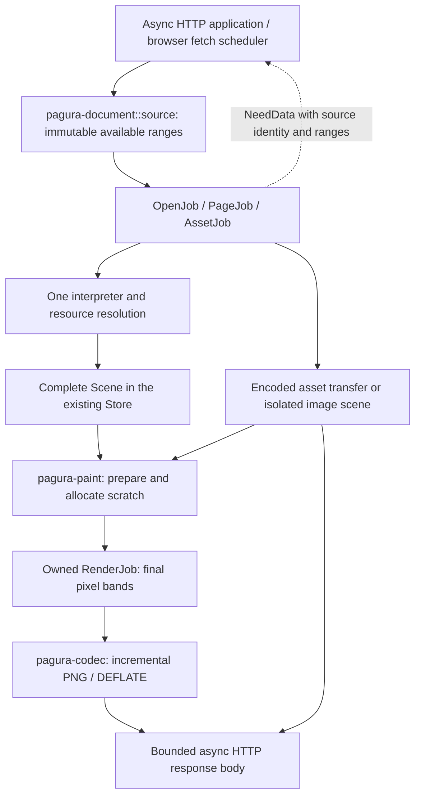

# Async PDF loading, image extraction and streamed image responses

Status: accepted architecture and implementation plan, 2026-10-26. Implementation
and its exit gates remain pending; accepted contracts do not establish completion.

Baseline: `fc09a6b202b53e4faba6d43e96bd20e30623c65d`, the consolidated synchronous
services and complete PNG implementation directly on `render/one-pass` at
`73e1ab018`. Public band output, CLI PPM streaming, complete PNG export and direct
image/thumbnail source extraction already exist. Section 2 credits these paths;
the packages below extend their shared implementations.
[ADR 0035](../adr/0035-progressive-sources-and-streaming-jobs.md) records the
accepted source, validation, ownership and extraction contracts.

This is the detailed design for **D01 and D02a's image/output slice** in the
[competitive parity plan](../COMPETITIVE_PARITY.md), not a parallel backlog.
P0–P3 implement D01 loading, P4 D02a extraction, P5/P6 shared resumable output
and encoding, and P7–P9 their integration and validation. Metadata/attachments,
other export formats and D02b editing remain in the umbrella plan. Native/WASM
worker scheduling remains a D01 obligation inside this same group. P0–P9 delivery
does not close group 11 until the scheduling gates in section 10 also pass.

## 1. Outcome and scope

An application should be able to fetch a PDF asynchronously, begin useful work
when the requested data is available, and return results while unrelated parts
of the PDF remain undownloaded. Support three distinct operations:

| Operation | Earliest useful result | Output |
|---|---|---|
| Discover and extract image assets | An image object and its required metadata or payload are available | Asset records, original encoded data, or a normalized PNG |
| Render a page or page region | Its scene is recorded and the requested render is fully prepared | Final pixel bands, incrementally encoded as one PNG |
| Display a page interactively | A requested tile is prepared | Independently completed tiles for a canvas |

Async fetching, CPU execution, encoding and sending are separate scheduling
stages. Each has bounded memory and explicit cancellation. A caller can use the
same engine through a blocking native API, an async server adapter, or the WASI
session protocol. No runtime, HTTP client or socket capability enters PDF
interpretation.

The first release includes ordinary PDFs through tail-first range access,
linearized first-page loading, existing supported encryption, explicit repair
fallback, image asset extraction, exact page/region rendering, incremental PNG
output, a native async server integration, and a protocol v2/browser path using
the same jobs. It does not promise rendering from an arbitrary PDF prefix,
decoding images from arbitrary compressed prefixes, or painting an incomplete
scene. All dimensions and source lengths remain within existing engine limits.

The implementation preserves ADR 0034's one interpreter, exact-only rendering,
source-ordered preparation, region-independent scene, and infallible band
execution. Rough previews, operator-by-operator page display, JPEG encoding,
parsed-object eviction, revision overlays and JSPI are
separate work. There is no second PDF parser or renderer for streaming.

## 2. What exists on the baseline

The baseline, rather than an earlier main checkout, determines the work:

| Existing component | Current contract | Consequence |
|---|---|---|
| [`Document::open`](../../crates/pagura-document/src/lib.rs) | Opens complete bytes; `history::Bytes` owns one `Arc<[u8]>` | Add range-backed storage and resumable opening |
| [`file_parser`](../../crates/pagura-document/src/load.rs) | Borrows the whole file at an offset | Add bounded file windows and distinguish a window boundary from EOF |
| [`xref::read`](../../crates/pagura-document/src/xref.rs) | Follows `startxref`/`Prev`; probes identities throughout the file | Make bootstrap resumable and define scoped validation explicitly |
| [`Document::pages`](../../crates/pagura-document/src/pages.rs) | Walks and caches the complete page tree | Add requested-page lookup without enumerating every leaf |
| Object/object-stream/page caches | `OnceLock<Result<...>>`; some terminal failures are retained | Temporary unavailability must bypass permanent result cells |
| [`RenderContext`](../../crates/pagura-render/src/context.rs) | Caches complete scenes in the existing `Store` | Keep that scene boundary and reuse the store |
| [`ImageSource`](../../crates/pagura-image/src/source.rs) | Owns complete encoded data after general-purpose filters; samples decode later | Lazy sample decoding does not yet provide lazy network access to the payload |
| [`Rendering::render_until` / `render_bands`](../../crates/pagura-paint/src/execute.rs) | One driver serves collection and a fallible band consumer; every call restarts from the first row | Add a persistent cursor; stopping is not currently resumable stepping |
| [`RenderContext::render_bands`](../../crates/pagura-render/src/context.rs) | Public final-band callback and stop callback, with preparation/repair/allocation preflight and one bounded RGBA output band | Preserve this API; add owned pause/resume and bounded leases for async demand |
| [CLI PPM conversion](../../crates/pagura-cli/src/commands.rs) | Streams the existing band API through a fixed 48 KiB RGB packing array; no full output surface | Preserve output/preflight/error behaviour |
| [Complete PNG export](../../crates/pagura/src/png.rs) | Facade, CLI, host and viewer encode complete page surfaces, including transparent RGBA | Adapt these APIs to the incremental encoder while retaining their complete-result contracts |
| [Source image services](../../crates/pagura-document/src/images.rs) | Direct resource/object images and stored thumbnails expose explicit stored/encoded bytes | Reuse these identities and stream readers; add broader resource contexts, interpreted occurrences and normalized output |
| [`png::encode`](../../crates/pagura-codec/src/png.rs) | Filters the whole image, compresses it, returns a `Vec<u8>` | Extend the existing encoder with incremental input and output |
| [`flate::compress`](../../crates/pagura-codec/src/flate/encode.rs) | Whole-input LZ77 and stored/fixed/dynamic block selection | Retain those algorithms while introducing bounded history and block state |
| [`SessionClient`](../../web/client.mjs) | One pending request serializes the session | A waiting job must return a response so range supply cannot deadlock |

PNG and DEFLATE encoding already exist as whole-buffer APIs. Final pixel-band
streaming, consumer errors and between-band stopping also exist. The remaining
work adds persistent jobs, incremental encoding and demand-driven service integration;
it does not create a second encoder, band driver or rendering mode.

## 3. Invariants and success criteria

1. A source identifies one immutable byte representation and revision history.
   Filling a hole never changes bytes or the meaning of a published object.
2. Unavailable bytes, a window needing extension, genuine EOF, a free object,
   an undefined object and malformed syntax are distinguishable states.
3. No unavailable result is cached as a terminal object failure, treated as
   null, converted to a repair, or reported as a successful partial scene.
4. A render publishes no pixels until scene recording, preparation, scratch
   allocation and output-encoder preflight succeed. Afterwards its prepared
   band execution performs no PDF reads and cannot fail semantically.
5. Pixel values and page-operation errors for the same validation policy and
   region do not depend on transport chunk boundaries, arrival order, band
   height, pauses or cache warmth. Error object/position and published repairs
   retain their source ordering within that operation. Diagnostics of concurrent
   independent jobs carry job/source identity; their global arrival order is not
   a cross-job source-order guarantee.
6. Source ranges, parser windows, pending operations, CPU admission, encoded
   queues and pinned resources have explicit budgets. A slow consumer cannot
   cause page-sized output accumulation or an unbounded task queue.
7. Waiting for input or output capacity retains no CPU worker permit and holds
   no document/store mutex. CPU-heavy work never runs inside an ordinary async
   executor poll.
8. Native, WASI SIMD and true scalar WASI retain byte-identical pixels. A fixed
   PNG profile also produces identical encoded bytes across those targets and
   arbitrary divisions of input rows and HTTP body chunks.
9. Independent assets are independent results. An inventory's successful end
   is explicit; an asset result never implies that the entire page or document
   has been validated.

## 4. Component boundaries



| Owner | Responsibility |
|---|---|
| `pagura-document` | Byte sources and leases, missing ranges, resumable index/object/page access, asset identity and resource inventory |
| `pagura-core` | Existing terminal errors, meters and store; a generic fallible store builder, without a dependency on document loading |
| `pagura-content` | The existing tokenizer over complete decoded content buffers; no networking |
| `pagura-interpret` | One interpretation path; shared image description/colour/mask resolution; complete scenes and image occurrences |
| `pagura-image` | Existing image codecs and encoded source materialization; no HTTP or image-file writing |
| `pagura-paint` | Prepared rendering, scratch ownership and persistent band cursor |
| `pagura-codec` | Existing PNG/DEFLATE algorithms extended for bounded streaming |
| `pagura-render` | Owned preparation/render jobs extending the existing public pixel-band interface |
| `pagura` | Public loading, extraction and output APIs; complete-buffer convenience functions |
| `pagura-host` | Protocol v2 job/source registry and bounded transfer messages |
| `web/` | Fetching, demand, cancellation and client presentation |
| New `integrations/async-server/` | Native HTTP/runtime adapter, CPU scheduling, source registry and streamed responses; its own integration workspace |

Engine product crates continue to depend only on the standard library and
workspace crates. The native integration workspace may use a pinned HTTP,
runtime and TLS stack, depending on the public `pagura` facade only. Its lockfile,
CI and deployment dependency review are separate; it cannot become a product
workspace member or weaken `tools/policy.py`. This boundary must be documented
before adding its manifest. Promotion of an external crate into the engine
would follow ADR 0008; this proposal makes no such exception.

## 5. Immutable sources and byte ownership

### 5.1 Source identity

Use an opaque `SourceId` and immutable `SourceVersion`, never a URL or memory
address as identity. Bind them to a known total byte length before range-based
opening. A host can establish identity through an immutable storage version,
a strong HTTP validator, or a single spooled response. A source without a
reliable version across requests uses one response and local spooling instead
of combining unverified ranges.

The sparse source accepts checked inserts `(source version, offset, bytes)`.
Out-of-bounds input and overflow are rejected before allocation. An overlapping
insert must agree with the previously accepted bytes; conflicting data makes
the source terminally inconsistent. Late responses for a closed or replaced
source are discarded by the host, and are never inserted into a new source.
Duplicate inserts do not count as useful progress or wake repeated work.

Source offsets are `u64` at the wire/application boundary. Conversion to a
WASM-sized position is checked after enforcing `Limits::file_bytes`; this does
not add support for documents larger than the engine's addressable limits.

### 5.2 Source API and leases

Accepted contracts; the implementation keeps these ownership and failure meanings:

```rust,ignore
pub trait ByteSource: Send + Sync {
    fn identity(&self) -> SourceIdentity;
    fn len(&self) -> u64;
    fn read_exact(&self, range: ByteRange) -> ReadResult<ByteLease>;
}

pub enum ReadFault {
    Unavailable(NeedData),
    Invalid(Error),
}

pub type ReadResult<T> = Result<T, ReadFault>;
```

`NeedData` includes source identity, the observed availability generation, and
a bounded, sorted, non-overlapping set of missing ranges. It contains no
credentials, URL, HTTP client, callback or runtime handle. `ByteLease` owns
shared backing storage and a slice extent. It is safe to move across tasks and
keeps that storage alive after a source map lock is released.

`SourceIdentity` uses an opaque `u64` registration ID plus a 32-byte version
token supplied by the host; neither is a URL or credential. The source descriptor
fixes its `u64` length, checked against `Limits::file_bytes` and the target address
width before allocation. Ranges are validated half-open intervals. Supplies carry
the exact identity and offset; a stale identity is rejected without changing this
source, while conflicting bytes for the same identity make it terminally invalid.
All overlaps are checked before any new fragment is published. One successful
insertion publishes its non-overlapping fragments and availability generation
atomically. Duplicate bytes do not advance that generation.

`SourceLimits` separately bounds retained allocation bytes, one assembly window,
chunk records, missing ranges and cumulative supplied/read work. Accepted chunks
and assembly allocations carry shared reservations; cloning a lease does not
charge the same backing twice, and closing a source does not release memory still
pinned by a lease. A complete-source materialization reserves any necessary copy
against that same retained-byte budget and the assembly allowance. The host also
accounts for incoming transport frames, which are outside the source store.

Provide `CompleteBytes` and `SparseBytes` implementations. A contiguous read
returns a lease into existing storage. A read across chunks uses a bounded,
charged assembly window when necessary; it does not concatenate the file.
The first release retains accepted source chunks until close, subject to a
source-residency cap. Eviction of source chunks and parsed object handles can
follow without changing identity or lease semantics.

`original_bytes() -> &[u8]` cannot describe a sparse document. Migrate its callers
to an explicit full-source materialization operation returning a lease or
`NeedData`; historical revisions use bounded prefix views of the same source.
Saving and signature verification request all required ranges explicitly.
Materialization accounts for temporary duplication and avoids copying an
already complete contiguous source.

### 5.3 API migration

Keep `Document::open(bytes, options)` as a complete-input convenience entry.
Add a source-opening job. Source-dependent document/interpreter APIs propagate
`ReadResult`; PDF-agnostic codecs, raster functions and painting keep terminal
`Result`. Convert `Error` to `ReadFault::Invalid` explicitly through `From`.
This is a pre-release source API migration, not a promise that existing borrowed
slice signatures can survive unchanged.

Complete-input convenience rendering continues to offer a terminal-error API,
using a checked complete-source capability. Partial-source users use the job
API. Protocol v1 remains a complete-input adapter, so no new wait state is
encoded as a v1 error. Update cross-crate call sites and tests together; avoid
maintaining a separate progressive object model or duplicate parser.

## 6. Windows, retries and cache publication

The syntax parser remains slice-based on its hot path. Introduce a file-window
adapter carrying the absolute origin and whether the window's end is the true
source boundary. It grows windows within a loading budget and uses the same
parser as the complete-buffer path.

A token, string, dictionary or indirect-object boundary crossing the available
window requests more bytes. The parser must report that condition structurally;
catching every `Syntax` error and assuming that more bytes will fix it is
incorrect. On complete stream buffers, truncation keeps its current syntax
meaning. Absolute positions remain file positions; decoded object-stream and
content positions remain stream positions.

Known stream extents can be fetched exactly after resolving `/Length` and its
dependencies. Unavailable length objects cannot become an absent length or
trigger a terminator scan. Existing cycle/depth protection still applies.
Repair scans that need a wider area first request that area; full reconstruction
uses the complete-input fallback in section 7.

Object, object-stream, page and historical-snapshot caches publish only a
completed result. A temporary `Unavailable` bypasses `OnceLock` publication.
Terminal top-level errors remain cacheable only where the existing path/context
rules make them permanent for this source and validation policy. Success in a
dependency remains reusable if the requesting operation later waits.

Generalize the existing `get_or_build` signature to accept a caller error type;
terminal-error callers keep the same method. The core store still caches values
only and knows nothing about PDF ranges. It must not hold a lock while building.

Private attempt state owns provisional diagnostics and reservations. Publish
them when the corresponding semantic unit completes, and never publish the
same repair repeatedly after a retry. Speculative dependency discovery may
fetch bytes, but cannot publish a later error/repair ahead of the source-ordered
consumer. Retry the smallest unfinished unit; keep bootstrap cursors and
completed dependencies instead of reopening the document after every chunk.

Availability-generation checks prevent retry spinning. Separately meter total
loading work and repeated scans so tiny fragments cannot reset a CPU budget
indefinitely. Count actual retry work in loading telemetry; transport retries
must not change a completed render's established render charges.

## 7. Bootstrap, revisions and validation scope

### 7.1 Ordinary PDFs

1. Obtain a stable source identity and total length; validate the file-size cap.
2. Fetch a bounded header probe and tail probe concurrently.
3. Find the newest `startxref`; request its table or stream.
4. Follow `/Prev` and hybrid supplements with the current cycle/revision/entry
   budgets until the authoritative newest-wins index is established.
5. Resolve security and the catalog using existing password/filter semantics.
6. Expose the loading document and requested-page operation.

Window growth and tail probing have finite limits. A missing `%%EOF` in an
unfetched tail is unavailable input; a missing marker in a complete eligible
search extent follows existing strict/repair policy.

### 7.2 Linearized PDFs

Recognize and validate the linearization dictionary and first-page index. Use
the advertised initial-page identity rather than assuming page zero. Check
declared file length and the current source version. Appended updates or an
inconsistent dictionary cause tail-first resolution before publishing results.
Hints prioritize/coalesce reads; they never bypass object identity, bounds,
security or revision checks. A first-page bootstrap must distinguish an unknown
index entry from an entry proven absent/free. Invalid hints fall back to the
ordinary loader without inventing repaired object contents.

No scene or normalized asset is cached until its effective object identities
are fixed. Background discovery must never replace the semantic meaning of a
published page with a newer revision.

### 7.3 Scoped validation is explicit

The baseline probes headers of unrelated indexed objects during opening. Doing
that across a network can fetch bytes throughout the PDF before page one is
ready. Requested-page loading therefore needs an explicit validation policy:

| Policy | Promise |
|---|---|
| `CompleteDocument` | Existing complete-input opening/validation, including global identity checks |
| `RequestedOperation` | Authoritative index/security plus identity and structure validation of every dependency the requested page or asset consumes |

This is a deliberate difference in validation scope, not an assertion that the
two open operations discover unrelated corruption at the same time. Include
the scope in readiness metadata. A page can be exact and valid while an unused
object elsewhere is corrupt. `validate_all()` completes global validation.

Parity tests compare full and sparse sources under the same scope. Separately
retain baseline complete-open failure tests. A wrong identity encountered on
the requested path still invokes the applicable reconstruction/failure policy.
Validation context must be part of a terminal-error cache's identity or be
handled outside that cache, so global checks cannot poison an operation-scoped
object result.

### 7.4 Repair fallback

Use the ordinary sparse path for structures whose dependencies can be bounded.
When the existing repair policy requires whole-file reconstruction, return a
specific complete-source requirement, fetch/spool the remaining bytes, and run
the existing reconstruction once. A file-size or residency limit produces a
typed failure; do not silently weaken repair or budget policy to keep streaming.
Fallback is observable in progress and telemetry. It is never triggered merely
by a transient hole.

## 8. Lazy page access and dependency planning

Add a page directory that can resolve one ordinal/path while applying the same
inheritance and geometry rules as the existing walk. Preserve occurrence
identity: the same indirect page object can occur under different inherited
attributes. A `/Count` can guide traversal, but it is untrusted input. Expose a
reported count separately from a verified count, and use an explicit bounded
walk/fallback when counts or tree structure cannot support a reliable ordinal.
Existing complete enumeration remains available for operations that need it.

`PageJob` uses the shared page/resource reader. It requests page ancestry,
content streams, referenced forms, actually used fonts and image/mask/colour
dependencies. Batch all ranges discoverable at a frontier, then continue after
they arrive. Further indirect/compressed references may require more frontiers;
the API does not promise a universal single network round.

Prefetch is a scheduling hint rather than a new validation pass or an excuse
to fetch every `/Resources` payload. The canonical interpreter remains the
authority for used resources, optional content, annotations, patterns and
forms. If interpretation discovers another dependency, it returns `NeedData`,
discards its unfinished scene and resumes through its cached completed inputs.
Do not build a second content interpreter to predict dependencies.

Honor device needs: text work should not fetch image payloads or outline data
it does not use. A complete image source is still required when the current
scene recorder describes an image; the initial release does not change its
full-stream codec validation contract to save a range request.

The scheduler has visible-request, explicit extraction and speculative-prefetch
priorities. Coalesce nearby ranges, deduplicate overlapping in-flight reads,
bound overfetch, and cancel speculation before foreground demand. Sharing a
fetch does not couple cancellation of independent consumers.

## 9. Image extraction contracts

### 9.1 Assets, resources and occurrences

An image asset is source data. An occurrence is a use of that asset with a
resource context and graphics state. Repeated uses are not duplicated assets.
An inline image is identified by its containing decoded content stream and
operator offset; the same inline image in a reused form remains one source
asset with multiple occurrences.

Provide three discovery scopes with explicit completeness:

| Scope | Traversal and meaning |
|---|---|
| `Object(id)` | Directly requested image object; no page enumeration |
| `PageResources(page)` | Bounded resource/form/pattern/mask resource walk; may include unused or hidden resources, and does not claim painted visibility |
| `PageOccurrences(page)` | The existing interpreter/complete scene supplies occurrences and resource context; includes inline images according to a documented page/annotation/layer configuration |

Occurrence records distinguish direct page/form/annotation uses from images in
pattern, mask and glyph definitions. A tiling-pattern definition is not expanded
into a potentially enormous list of raster cell instances merely to enumerate
images. Include the definition context, enclosing occurrence path and transform;
do not claim that these records count every visible painted instance. Actual
composited appearance is the `PageCropPng` contract.

An optional `AllAssets` inventory inspects the effective xref's objects in a
bounded cursor. It may need many metadata reads and whole decoded object
streams, but never decodes all image samples just to enumerate them. It covers
indirect image objects, not every inline image unless content traversal is also
requested. Publish that distinction in its manifest.

Use `AssetId = (source version, object identity or inline locator)` and an
independent occurrence ordinal/path. Include the resource context in normalized
export cache keys because named colour spaces can resolve differently. A mask
can be an independently addressable asset and a dependency of another image.

### 9.2 Export modes

| Mode | Meaning and first-release behavior |
|---|---|
| `StoredStream` | Exact encoded file-stream bytes, possibly encrypted or wrapped in PDF filters; `application/octet-stream` plus metadata, never mislabeled as a viewable image |
| `EncodedAsset` | Decrypt and remove general-purpose filters while retaining a supported image codec's payload and PDF interpretation metadata |
| `NormalizedPng` | Render the image in isolation with its PDF decode, colour and intrinsic mask semantics into straight RGBA/sRGB output |
| `PageCropPng` | Render a rectangle of the actual page when clipping, transforms, page soft masks, blend modes or backdrop matter |

A standalone-JPEG passthrough is offered only after verifying that its metadata
and PDF interpretation permit the promised result. Do not equate any trailing
`DCTDecode` stream with appearance-equivalent browser JPEG output. Handle
`/Decode`, colour-transform parameters, CMYK, ICC profiles, masks and wrappers
explicitly. First-release JPEG passthrough eligibility is deliberately narrow;
other encoded payloads can remain typed binary assets with a sidecar. Decode
validation of the full codestream is not implied by raw/encoded transfer.

Refactor the existing image-description and colour/mask resolution out of its
machine-private placement into one reusable resource service in
`pagura-interpret`. Both the interpreter and extractor call it. `pagura-image`
continues to decode samples; it does not acquire PDF colour interpretation or
HTTP responsibilities.

Build an isolated-image scene through the same model/preparer for normalized
output. Its contract includes intrinsic masks and Matte handling, but not the
parent page's clipping/compositing backdrop. A stencil requires an explicit
paint colour, or is exported as a clearly labeled mask; no arbitrary colour is
invented. Pixel-grid placement and orientation are explicit options. Page crop
uses the ordinary page path and its established region semantics.

### 9.3 Streaming results and independence

An inventory emits asset metadata as independently validated discoveries occur,
with stable IDs and discovery ordinals. Payload jobs start as soon as their
individual dependencies are ready. Default delivery may be in readiness order;
clients can reconstruct discovery order from ordinals. No partial interpreter
scene is published as an occurrence inventory.

Events end with `InventoryComplete` or a structured failure/cancellation.
Previously completed asset transfers remain independent successes. A manifest
must distinguish discovery from payload readiness and must not claim an asset
is complete merely because its dictionary is present. A missing mask or image
length remains a dependency rather than a repaired/empty payload.

Raw/encoded transfer can iterate source ranges after stream extent/security
validation, subject to the transformations required by its filters. Normalized
PNG decodes and validates the needed source before image output is committed.
Full-stream-only filters and existing image decoders may require a full asset
buffer. Incremental decoder internals are not a hidden prerequisite of this
release.

## 10. Owned jobs and async scheduling

The core exposes owned jobs whose `advance` methods do bounded synchronous
work and return progress, a typed wait, a completed value, cancellation, or a
terminal error. They do not own a runtime or call the network. The async adapter
turns input waits and output demand into futures/streams.

```rust,ignore
pub enum JobPoll<T> {
    NeedData(NeedData),
    Yielded,
    Ready(T),
    Cancelled,
}

// Terminal PDF/limit errors remain Error. NeedData is a control outcome.
pub type JobResult<T> = Result<JobPoll<T>, Error>;
```

Use separate opening, page-preparation, inventory, asset-transfer and band-output
jobs with a small shared driver convention. Avoid a single public enum containing
every HTTP and graphics state. A completed preparation hands an owned render
session to the output stage, so no data wait can appear after rendering begins.
For a multi-item inventory/output, the ready value is an explicit
`Item(value)` or `Finished(summary)` event. A yield, a discovered dictionary, or
the end of one chunk is never implicit completion of the containing operation.

The server driver follows this loop:

1. Reserve request/session memory and output capacity, then admit CPU work.
2. Move the job into a bounded CPU task for the next eligible step.
3. On `NeedData`, release CPU admission and await deduplicated range requests.
4. On a completed band/chunk, release CPU admission and yield output.
5. Await downstream demand before scheduling the next step.
6. On cancellation, remove demand, cancel unshared requests and release leases
   and reservations after any executing non-preemptible unit returns.

Source insert notification uses generation checks and register-then-recheck
logic to avoid lost wakeups. There is no polling timer or worker blocked waiting
for bytes. Never hold a source, object or store mutex across `.await`.

Native and browser/WASI worker scheduling is part of this group's completion.
The shared scheduler contract bounds queued jobs, running CPU units, live source
bytes and pinned output slots, with foreground, explicit extraction and speculative
priorities and bounded starvation. Cancellation removes only the owning demand;
shared source requests continue while another job needs them. Shutdown joins or
terminates workers and releases their reservations. Native workers share immutable
prepared scenes and own scratch per executing region. Isolated WASI worker
instances use the same jobs and protocol; any copied source/store data is charged
to the aggregate worker budget. Worker count must not affect output bytes, ordered
operation diagnostics or terminal outcomes. Tests cover one and multiple workers,
slow inputs/outputs, priority inversion, cancellation and teardown.

Recording/preparation contain CPU work that may remain one non-preemptible unit
initially. Running them on a bounded pool keeps the server executor responsive,
but does not make them instantly cancellable. Measure that latency and add
private resumable preparation checkpoints only if needed, preserving ordered
failure and publishing no partial scene. Rendering cancels/pauses between bands.

Tokio's blocking tasks need explicit CPU admission and cooperative cancellation;
aborting their task handles does not stop already executing work. See the
[Tokio scheduling contract](https://docs.rs/tokio/latest/tokio/task/fn.spawn_blocking.html).

## 11. Resumable final pixel bands

Add an owned render session holding `Arc<PreparedScene>`, `Scratch`, a monotonic
global-band cursor and a preallocated output-band buffer. Construct a temporary
borrowed execution view during each step; avoid a self-referential struct
holding a `Rendering<'a>` that borrows its own fields.

Initialize the workspace and active-item lists once. `next_band` executes one
band, advances the cursor once, and returns its global row range and immutable
pixel bytes. Pausing must not call `workspace.restart()` or repeat earlier
bands. The current `render`, `render_until` and `render_bands` APIs become
adapters over the same cursor. Each existing API call still starts a new render
and retains its completion/cancellation/consumer-error meaning; only the new
owned session resumes across steps. Reuse the current driver's preflight and
output accounting rather than implementing a second band executor.

Keep every buffer format, culling decision, coverage calculation and render
charge in the existing preparation path. Preparation and scratch allocation
finish before the session is publishable. Output-band storage is also reserved
before execution, so yielding a band cannot introduce allocation failure into
the executor. A consumer-held lease pins a bounded output slot; the producer
cannot overwrite it.

Expose band metadata: requested region, full output dimensions, starting row,
row count, stride, and alpha/colour representation. The executor produces
premultiplied RGBA8. PNG requires straight samples; the output adapter performs
the same conversion policy as `Pixmap::to_straight_rgba`, one row at a time,
including the alpha-zero rule. A canvas/native caller may consume the native
representation explicitly.

For one region, concatenating bands must equal the existing collected render
byte for byte. Sending final rows early requires the whole requested region's
preparation, not just the first band's dependencies. Independent tile jobs can
prepare smaller regions; an arbitrary late PDF operator can affect the first
row, so streaming content tokens directly to final pixels is outside this plan.

## 12. Incremental PNG and DEFLATE

Extend `pagura-codec::png` and `flate` instead of adding an encoder crate.
The initial profile remains deterministic, non-interlaced, eight-bit Gray/RGB/
straight RGBA. Reuse filter scoring, Paeth, CRC, Huffman construction and block
selection. The existing whole-buffer APIs collect the incremental implementation
once parity is established; they do not maintain a second encoder algorithm.

PNG filtering retains the preceding unfiltered row plus bounded candidate/best
row buffers. DEFLATE retains bounded history, lookahead, a block input buffer,
tokens, bit state and an incremental Adler checksum. Refactor the matcher away
from random access to the entire input. Preserve a bounded chain search and
stored-block fallback; no input-sized token or filtered-image allocation.

All consecutive IDAT chunks form one zlib stream. Never call whole-buffer
`compress` for each band and concatenate the resulting zlib streams. The
container and DEFLATE block sizes do not need to match scanlines or bands.
[PNG IDAT](https://www.w3.org/TR/png-3/#11IDAT),
[zlib](https://www.rfc-editor.org/rfc/rfc1950.html) and
[DEFLATE](https://www.rfc-editor.org/rfc/rfc1951.html) define these boundaries.

Define canonical compression blocks from filtered-byte offsets and a fixed
profile, independent of input band height or response demand. Emit completed
compressed bytes at these fixed checkpoints with bounded IDAT payloads. This
provides useful early chunks without a timing-dependent flush changing encoded
bytes. Finish with the zlib checksum and IEND exactly once. A small final block
must not wait for an output buffer to fill.

Encoder preflight validates dimensions, row width/count, output format and
arithmetic; reserves all working buffers; and checks a conservative encoded-size
bound including stored-block fallback and PNG chunk overhead. Separate encoding
work/bytes/output budgets are explicit. A streaming request whose worst-case
bound cannot fit its output quota fails before headers, even if a speculative
full-image compression might have fit. Document that tradeoff.

Output is pull-driven. The encoder accepts only input that fits its bounded
state and yields complete byte chunks whose ownership is explicit. Backpressure
does not trigger unbounded internal buffering. Transport cancellation stops
encoding and leaves no successful IEND/completion event. Ordinary misuse and
transport errors remain outside the infallible graphics executor's contract.

The encoder's existing untagged colour policy is preserved for compatibility;
the service documents its output as sRGB working-space pixels. Explicit sRGB/ICC
PNG metadata can be a separately tested option, not an incidental change to
pixel values or current whole-buffer output.

## 13. HTTP source adapter

The application registers authorized source handles; rendering endpoints take
those handles rather than arbitrary URLs supplied by a PDF. URL resolution,
redirects, authentication, remote-host policy, spooling and TLS belong to the
application. This preserves the engine's existing provider/capability boundary.

For range-backed HTTP sources:

- Probe with an actual bounded GET; `Accept-Ranges` alone is not evidence.
- Validate each `206` status, `Content-Range`, byte count, total length and
  source validator before insertion. Prefer one coalesced range per request;
  multipart byte-range support is not needed initially.
- Use a strong version and conditional range requests where applicable. Do not
  combine bytes from two representations. A changed version invalidates its
  jobs and starts a distinct source identity.
- If a server ignores Range and returns `200`, treat it as a whole response,
  never as the requested offset. Reconcile its identity or restart the source.
- Treat `416`, truncated responses and inconsistent totals as bounded retry or
  terminal source failures; they cannot cause endless re-probing.
- Ensure byte offsets describe the bytes supplied to the PDF parser. Automatic
  HTTP content decoding can break that correspondence; disable sparse access
  for an incompatible content encoding and spool a single decoded response.
  Browser code cannot assume it can set forbidden encoding headers.
- Unknown lengths and sources without stable cross-request identity use a
  bounded spool, becoming complete input when finalized. A later optimization
  may add unknown-length linearized loading under a separate contract.

Configure finite in-flight request count, merge distance, overfetch, transfer
bytes, retry count, timeout and idle lifetime. Dedupe shared ranges per source;
backpressure from one response does not suspend other consumers of that source.
Fetch/close races are resolved by source version and demand ownership.

These checks implement [HTTP range and validator semantics](https://www.rfc-editor.org/rfc/rfc9110.html#name-range).

## 14. Native async webserver integration

Use one native integration workspace depending only on the public facade.
Its runtime adapter owns a document registry, range coordinator, bounded CPU
executor, job table and response streams. A Tokio/Axum implementation is a
concrete reference integration; source fetching can use the application's
existing HTTP client. The engine never acquires those dependencies.

Proposed routes use zero-based page indexes, matching the library:

| Route | Contract |
|---|---|
| `POST /v1/documents` | Register an application-controlled source or streamed upload; return an opaque handle and reported readiness |
| `GET /v1/documents/{id}/pages/{page}/image.png` | Exact page or explicit region PNG with checked scale/background options |
| `GET /v1/documents/{id}/images` | Bounded inventory events for an explicit discovery scope |
| `GET /v1/documents/{id}/assets/{asset}/data` | Explicit stored/encoded mode; checked media type and metadata |
| `GET /v1/documents/{id}/assets/{asset}/image.png` | Isolated normalized PNG with explicit context/stencil options |
| `DELETE /v1/documents/{id}` | Release this registration and cancel its owned demand; other registrations keep their own leases |

Inventory responses use NDJSON records with source version, scope, asset ID,
discovery ordinal and payload readiness, followed by a terminal record. Large
payloads use their own response streams rather than base64 in metadata events.
Asset IDs are opaque handles validated against the registered source.

Illustrative application shape, not an existing API:

```rust,ignore
let prepared = service.prepare_png(document_id, request, cancellation).await?;
let headers = prepared.headers();
let body = prepared.into_byte_stream();
// The selected HTTP framework adapts this stream to its response body.
respond(headers, body)
```

For a PNG route, finish page/asset preparation and encoder admission before
committing status/headers. Map terminal errors to structured application
responses before that point, preserving the engine's error kind, object,
position and feature/repair tag without exposing source credentials. After
commit, a disconnect, timeout or write failure terminates the response; it
cannot retroactively change the HTTP status. Emit successful completion and
populate a completed-output cache only after IEND and stream completion.

Use a stable application error envelope. Invalid request options map to `400`,
malformed/unsupported PDF operations and PDF password requirements to `422`,
declared upload/file-size excess to `413`, exhausted service admission to `429`
or `503` according to its retry policy, and upstream fetch failures/timeouts to
`502`/`504`. Application authentication/authorization uses its own `401`/`403`
policy; a PDF password error is not an HTTP authentication challenge. Preserve
the more specific engine/source code in the envelope, including which limit
failed, rather than collapsing every engine limit into a service-overload error.

Use `Content-Type: image/png` and an unknown-length streaming body. The framework
chooses HTTP/1.1 chunked framing or HTTP/2/3 DATA frames. Do not buffer merely to
compute `Content-Length`, and do not gzip an already compressed PNG by default.
Set caching by immutable source version plus page/asset/context/options, and
separate complete cache entries from in-progress streams. A client Range request
against an unfinished generated PNG is unsupported; resume/reuse is through a
completed cached artifact or a new operation.

Reserve at most a small fixed number of band/chunk slots per response. Polling
the body drives production; a full queue releases CPU admission. No separate
unbounded producer continues rendering behind a stalled socket. Limit active
jobs and aggregate memory as well as worker count. A shared source/document
context does not mean one request can mutate another's scratch state.

Axum's [streaming body interface](https://docs.rs/axum/latest/axum/body/struct.Body.html#method.from_stream)
provides the response-side adaptation. The integration owns cancellation tokens
because dropping a blocking task's handle does not preempt its CPU operation.

## 15. Protocol v2 and browser reuse

Keep v1.0–1.12 behavior frozen and complete-buffer based. Add a negotiated v2
surface with explicit source and job handles. Final wire tags/layout are a
deliverable of the contract package, generated from the existing canonical
protocol tables rather than hand-maintained JS duplicates.

| Message family | Purpose |
|---|---|
| Source create/supply/finish/close | Versioned length, checked byte ranges, input finalization and ownership |
| Open/page/inventory/asset job create | Select a bounded operation and its validation/export options |
| Job advance | Return NeedData, yielded progress, ready metadata/output or terminal state |
| Output acknowledge/pull | Advance only when the consumer releases a slot or requests another chunk |
| Job cancel/close | Release demand and buffers at supported boundaries |

A `NeedData` result completes its request. The client can then supply ranges
and advance the job; no request remains pending waiting for another message
that the same serial queue cannot send. Output chunks also have explicit
sequence numbers, byte bounds, representation and terminal completion.

The browser keeps network access in JS and gives the WASI command only supplied
bytes. Existing Atomics transport can drive the new protocol; JSPI is not a
dependency of progressive PDF input. Use ordinary async fetch in the client and
bounded frames through the established channel. Preserve request IDs, viewport
generation checks, handle lifetimes and cancellation semantics.

For a conventional image URL, stream PNG and measure actual browser first paint;
decoder and proxy buffering affect display. For deterministic visual progress,
request completed tiles and draw them to a canvas with generation checks. A
client path that first collects a response into a Blob intentionally waits for
the whole body. Neither output choice changes the exact-rendering pipeline.

## 16. Memory, work, ordering and cancellation

Do not add unrelated meanings to existing `Limits` fields. Introduce typed
loading/extraction/encoding configurations and amend ADR 0016 where operation
budgets enter the engine. The baseline `Limits` record is already at its stated
size threshold; use separate domain groups/configurations rather than blindly
appending `usize` fields. Session-wide counts/queues belong to host/server
limits, not one PDF render's budget.

| Quantity | Owner and accounting |
|---|---|
| Declared file bytes | Existing `Limits::file_bytes`, checked before bootstrap |
| Accepted resident source chunks and assembly windows | Source/loading byte budgets; charge allocations and active leases |
| Loading metadata, frontiers, pending ranges and retry scans | Loading limits and meters; cumulative for the operation |
| Parsed object/page caches | Existing document retained-memory accounting |
| Scenes, fonts, decoded images and pinned store values | Existing Store plus active-job accounting; pinned live values count even when not evictable |
| Prepared geometry, paint, scratch and output band storage | Existing render work/byte contracts, with an explicit amendment for output slots |
| Extraction records, mask graphs and result count | Extraction/traversal limits, without borrowing token or render budgets |
| PNG rows, DEFLATE history/tokens, chunk slots and encode work | Encoding domain limits, reserved before output |
| Aggregate jobs, transferred bytes, retries, socket buffers and spools | Native service/session limits |

The peak-memory model includes source residency, document caches, the store and
active pinned values, prepared render workspaces, image-source copies, decoder
temporaries, encoder buffers and bounded transport slots. Account shared
backing allocations once while also tracking which jobs pin them. Count real
copies between JS and WASM and during full-source materialization. A low store
capacity alone is not an aggregate service memory bound.

Network requests may finish out of order. Page recording and preparation still
publish semantic failures/repairs in their established order. Independent asset
jobs can complete in readiness order with stable IDs. Cancellation is a terminal
job state, distinct from a successful complete render and from a PDF failure.
No background-filled rows or incomplete PNG receive a success marker.

## 17. Implementation packages and dependencies

The remaining deliverables in these packages are pending; basic band output is
already delivered. The effort column preserves the original proposal's rough
sizing for context, **not a current estimate**. P0 must resize the work against
this baseline, especially P5, before scheduling. Use one
integration line derived from the current `render/one-pass`; rebase onto its
finalized head before implementation and rerun the baseline if source contracts
have moved. These packages do not authorize starting implementation on their own.

| ID | Remaining deliverable and primary files | Depends on | Earlier effort hypothesis |
|---|---|---|---:|
| P0 | Implement the accepted source/fault/job/validation/export/band/encoder contracts; baseline existing complete behavior; domain-budget amendments | — | 2 days |
| P1 | `pagura-document/src/source.rs` and modules; leases, range map, complete source, checked windows in core syntax/document adapters | P0 | 4–6 days |
| P2 | Resumable builder/xref/object streams/security; ReadFault propagation; retry-safe caches; historical source and whole-source API migration | P1 | 6–9 days |
| P3 | Lazy page directory, scoped validation, dependency frontiers and repair fallback; complete-input parity | P2 | 4–6 days |
| P4 | Asset/resource inventory and export jobs; shared image description; encoded eligibility and normalized isolated-image scenes | P2, P3 for page scopes | 4–6 days |
| P5 | Persistent owned session/cursor and bounded band leases over the existing driver; preserve collected, callback and stop APIs | P0 | 2–3 days |
| P6 | Incremental PNG/DEFLATE state; row conversion; preflight bounds; whole-buffer collection adapter | P0; P5 for end-to-end bands | 3–5 days |
| P7 | Native async integration: source registry/ranges, bounded CPU driver, endpoints, streamed bodies, disconnect and slow-reader behavior | P3–P6 | 5–8 days |
| P8 | Protocol v2 tables/frames/registry, JS range driver, pull/ack and generation cancellation; WASI parity | P3–P6 | 3–5 days |
| P9 | Adversarial/fuzz/parity/HTTP tests, browser and memory measurements, docs and performance exit report | P1–P8 | 5–7 days |

The original hypothesis totalled 38–57 engineer-days (8–12 weeks for one
engineer); it has not been validated or carried forward as a commitment. P5/P6
can proceed independently of the loader after P0; P4 and transport adapters can
overlap once their contracts exist. Two contributors with stable contracts may
shorten elapsed time, but the loader and final integration remain dependencies.
The broader scope here includes extraction and two host adapters in addition to
partial loading; it is larger than a loading-only estimate.

### P0: contracts and baseline

- Define concrete public structs/enums and the complete-input compatibility
  layer. Enumerate every `original_bytes`, `file_parser`, `.ok()`,
  `MissingObject`/`Syntax` recovery catch and permanent `OnceLock` result.
- Fix policy names and tests for complete-document versus requested-operation
  validation. Specify page-count confidence, image scopes and normalized-image
  appearance semantics before changing consumers.
- Record baseline pixel hashes, diagnostics, structured errors, render charges,
  PNG decoded pixels and encoding profiles; do not refresh goldens to accept
  unrelated changes.
- Define the separate native integration dependency boundary and the v2 wire
  contract before adding runtime dependencies or handler code.

### P1–P3: progressive document foundation

- Test sparse storage and window parsing independently before migrating reads.
- Migrate source-dependent call paths through one ReadFault channel. Audit
  navigation/forms/signature/revision readers too, even where their first
  progressive use requires complete-source admission.
- Preserve strict/repair distinctions and undefined-reference semantics.
- Complete ordinary tail-first opening before enabling the linearized shortcut;
  then prove hint fallback and appended-update handling.
- Introduce lazy page access while retaining complete enumeration; compare
  inheritance, repeated page occurrences, geometry and damaged-tree fallback.
- Finish the generic store builder and cache publication audit before allowing
  asynchronous retries to share a context.

### P4: extraction

- Ship explicit discovery/export enums, stable IDs and terminal inventory
  records before adding broad convenience methods.
- Implement direct-object and page-resource scopes first; add exact occurrences
  through the existing interpreter/scene. Do not silently drop forms, inline
  images, annotations, masks or pattern contexts from a promised scope.
- Reuse image description/colour/mask resolution in normalized output. Verify
  encoded passthrough eligibility and sidecar metadata independently.
- Exercise independent readiness and partial inventory failure without claiming
  complete-page success. Large encoded transfers obey the same source and
  output caps as other jobs.

### P5–P6: streamed output on complete inputs first

- Implement and verify persistent stepping against both existing collection and
  callback output before
  connecting any network source.
- Implement incremental compression/filtering as the encoder's canonical
  state machine. Test feeding one byte, one row, one band and irregular row
  batches; all yield the same profile bytes.
- Connect band conversion to PNG with fixed output slots and a deliberately
  slow sink. Assert that no full-frame allocation appears in the streamed path.
- Keep the existing collecting APIs as convenience adapters with the same
  decoded output. An intentional compressed-bitstream change must be documented
  and validated, rather than confused with a pixel regression.

### P7–P8: host integration

- Establish the native vertical slice using a complete local source and streamed
  PNG; then substitute the sparse HTTP source without changing the renderer.
- Add extraction inventory/payload routes and concurrent source-sharing tests.
- Implement pull-driven job scheduling, deadlines and post-header failure
  behavior. Make source/version and job lifecycle observable before load tests.
- Add v2 alongside v1, not by reinterpreting old frames. Prove that source supply
  can always run after NeedData, including with a single serial WASI command.
- Add browser tile presentation and an ordinary streamed-PNG experiment; report
  first byte, first decoded pixels and visible paint separately.

### P9: completion

- Run the test matrix below and the existing repository gate.
- Publish measured first-use latency, request/overfetch counts, peak memory and
  complete-input overhead. Resolve regressions before declaring the package done.
- Update architecture, protocol, status, roadmap and examples to describe only
  delivered behavior. Keep unsupported cases and repair fallback explicit.

## 18. First end-to-end slice

The first useful demonstration takes a well-formed ordinary PDF behind a local
range server and returns one page as a streamed PNG. It fetches the header/tail,
loads the authoritative index and requested page dependencies, prepares that
page, emits a final band into the incremental encoder, and sends a nonempty
image-data chunk before execution finishes. Unrelated large assets remain
unfetched. The same slice also succeeds from a complete buffer.

Capture an event trace with monotonic timestamps for request admission, range
requests/completion, page readiness, scene readiness, preparation completion,
first band, first image-data chunk and completed response. A PNG signature alone
does not count as useful image output. This slice is evidence for the plumbing;
it does not substitute for encryption, repair, extraction or hostile-input gates.

## 19. Verification matrix

| Area | Required checks |
|---|---|
| Source storage | Random order, duplicate/overlapping inserts, conflicting versions/data, overflow, close races, exact missing-range sets and lease lifetime |
| Parsing | Splits inside numbers, names, strings, escapes, delimiters, stream headers and terminators; window end versus EOF; absolute error positions |
| Xref/revisions | Tables/streams/hybrids, compressed objects, Prev cycles, appended revisions, free generations, undefined refs, linearized initial-page variants and invalid hints |
| Encryption | Existing supported passwords/filters, encrypted images/object dependencies, wrong/missing passwords, and no source-version cache reuse |
| Page directory | Inheritance, repeated objects, counts, direct/repaired children, cycles, missing ancestors and bounded fallback; reported versus verified totals |
| Caches/diagnostics | Cold/warm/retry equivalence, unavailable never retained, no duplicate repair publication, source-order terminal results and reservation cleanup |
| Extraction | Direct/shared/unused/hidden resources, forms, inline images, patterns, annotations, stencils, colour-key/explicit/soft masks, Matte, ICC/CMYK and Decode arrays |
| Asset modes | Exact stored bytes, correct decrypted/unwrapped data, narrow standalone eligibility, isolated normalized output and actual page crops |
| Bands | Collect versus stream identity, pause after every band, different heights, partial final band, tile partitions, alpha and all preparation formats |
| PNG/DEFLATE | Independent decoding, CRC/Adler/framing, all colour types/filters/block kinds, empty/final blocks, transparent samples, chunk/row feeding invariance and preflight caps |
| HTTP input | Correct ranges, ignored Range, 416, missing/stale validators, inconsistent totals, truncation, encoding, redirects and bounded retry/spool fallback |
| HTTP output | Useful chunks before render completion, slow readers, disconnect before/during each stage, post-header failure, exact completion and bounded queues |
| Async fairness | Many jobs with small CPU capacity; no executor-thread CPU stalls, deadlocks, lost wakeups, unbounded producers or orphaned tasks |
| Protocol | Version negotiation, v1 compatibility, stale/unknown handles, sequencing, malformed/oversize frames, NeedData/supply liveness and cancellation |
| Portability | Native, WASI SIMD and true scalar WASI pixel/PNG identity; 32-bit conversion/budget paths; retained-size telemetry treated according to existing parity policy |

Generate synthetic fixtures through `tools/fixturegen/` without invoking Pagura.
Add requirement ledger entries and stable fuzz replays for newly discovered
failures. Python's standard `zlib` plus a small independent PNG framing/filter
reader can verify encoder output without using Pagura's decoder as its oracle.
Use an external standards-aware image decoder as additional development
validation when available; record its version and distinguish that check from
product dependencies. Native HTTP fixtures should deliberately stall and reorder
input/output under a deterministic test controller.

Run focused crate/public-API tests first, then `uv run tools/check.py` after
integration. The latter is the existing full repository gate; it is not a
replacement for new streaming HTTP tests or an automatic performance
certification. Scalar WASI checks use
`RUSTFLAGS="-C target-feature=-simd128 -C overflow-checks=on"` and an isolated target directory, so an
old SIMD artifact cannot satisfy the scalar gate.

## 20. Measurements and release gates

Measure three scenarios separately: already-complete input, a distant range
source with low bandwidth/high latency, and a slow output consumer. Include
text, image, vector, shared-resource and repaired documents using corpus-neutral
case identifiers in repository reports.

Record at least:

- Admission-to-page-ready, scene-ready and preparation-ready times.
- First output byte, first nonempty PNG image-data chunk, first client-decoded
  pixels, first browser paint, and full response time.
- Requested/received/useful/overfetched bytes, request count, dependency rounds,
  duplicate avoided requests, retries and full-download fallback reason.
- CPU recording, preparation, rendering and encoding time; time actually waiting
  for input/output; cancellation latency by stage.
- Source/cache/pinned/prepared/encoder/transport/spool peaks and aggregate
  service RSS/WASM memory; peak queued bytes and active CPU tasks.
- PNG size/compression effort and complete-input throughput against the baseline.

Release gates:

1. Every correctness, lifecycle, budget and portability test above passes; no
   weaker pixel tolerance, skipped owned case or hidden fallback is introduced.
2. A controlled sparse fixture renders/extracts its selected result while
   unrelated large content remains unfetched. Publish actual bytes and rounds,
   rather than one universal savings percentage.
3. A controlled large output emits useful image data before the last band, with
   bounded queues under a stalled reader. Streaming pixel-output memory scales
   with width/band/queue sizes rather than full output height; source and
   preparation memory are measured separately.
4. The same complete-input renderer and collected/streamed encoder stay within
   measured baseline noise, or any material regression has an explicit reviewed
   explanation before release. Do not invent a threshold after seeing results.
5. Complete-document validation and operation-scoped validation are both tested
   according to their declared promises. Source chunking cannot change results
   within one policy.
6. The native integration and v2 browser path demonstrate cancellation, source
   consistency, backpressure and terminal completion. An HTTP 200 or early
   header by itself is not evidence of a successfully streamed image.

## 21. Design alternatives and consequences

| Alternative | Assessment |
|---|---|
| Make every parser/renderer function async | Introduces suspension through CPU-heavy code without solving CPU admission, byte ownership or final-pixel dependencies; keep async in the host driver |
| Block a worker in `Read + Seek` while fetching | A useful private experiment, but ties worker capacity to network latency and complicates WASI supply/cancellation; not the public contract |
| Download all bytes, render all pixels, then chunk the completed file | Valid complete-input compatibility path, but does not satisfy early loading or bounded streamed pixel output |
| Start painting as PDF operators arrive | A later operator can affect an earlier row; conflicts with the complete-scene and preflight contracts |
| Send completed tiles | Supported for interactive clients; gives explicit visual progress, while one PNG remains the ordinary image endpoint |
| Add a second PNG/compression library | Unnecessary: the baseline already owns both encoders; extend their state instead |
| Fold parsed-object eviction and revision overlays into this release | Broadens API/retention work beyond streaming's requirements; preserve lease/identity seams and implement that roadmap item separately |

The main long-term cost is the explicit availability channel across document
consumers and the source API migration. The benefit is one loading model that
serves browser, native server and complete-buffer workloads, with useful early
results and predictable memory. The graphics kernels and error/precision
contracts remain the accepted render/one-pass architecture.

## 22. Accepted contracts and completion tracking

ADR 0035 fixes source identity/lease ownership, explicit materialization, the two
validation policies, retry-safe cache/diagnostic publication, owned job/output-slot
states and context-aware extraction identity. Source-dependent APIs migrate once;
complete-input convenience entry points and protocol v1 adapt that same path.
The separate native integration dependency boundary preserves engine policy.

The four contracts require concrete admission tests before adapters are connected:
leases remain charged until their last owner drops them; unavailable input cannot
publish a failure or repair; output demand bounds runnable work and pinned slots;
source/occurrence identity prevents cross-context normalized-image cache reuse.
P0–P9 and native/WASM scheduling remain implementation/validation obligations on
one integration line. Hosted functional run 40333159571 passed all three operating
systems for the service baseline's product sources; this does not validate any
new source/job code. Runtime, corpus and performance checks remain hosted under
ADR 0031, including the commands described in this plan.
