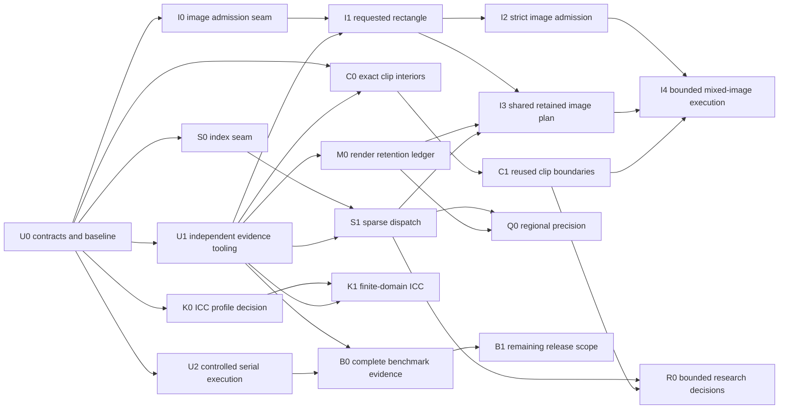

# Unified renderer implementation plan

Status: plan committed; initial tooling under implementation, 2026-10-20. Baseline:
`359e19dda5b78a23675678b6a153da7ab7fdc2c5`.

The [implementation log](unified-renderer-progress.md) records partial U1/U2
delivery and pending validation; renderer work and performance results remain
future stages. [ADR 0016](../adr/0016-unified-renderer.md) defines the
architecture; the [validation plan](unified-renderer-validation.md) defines
binding evidence and proposed experiment thresholds. Existing accepted
contracts continue to apply until a change is reviewed and validated.

## Outcome and priorities

Unify preparation and execution around the existing semantic display list.
Keep Exact as the default. Transfer useful Competitive mechanisms into shared
execution only when independent evidence supports their admission. Preserve
an explicitly requested approximate policy while it offers a measured benefit.

| Priority | Outcome | Why it precedes later work |
|---|---|---|
| P0 | Independent evidence, repeatable benchmarks, accounting contracts | Prevent circular accuracy claims and unmeasured complexity. |
| P1 | Sparse ordered dispatch and exact clip reuse | Remove repeated work without changing the current sampling contract. |
| P1, parallel design lane | Requested-region image rendering | Concrete isolated gap; does not depend on a new intersection solver. |
| P2 | Shared certified image kernels and bounded retained preparation | Turn proven local gains into one maintained pipeline. |
| P3 | Regional precision and profile-triggered ICC specialization | Require dependency/accounting evidence and a measured bottleneck. |
| Research | Local visible faces, cubics, final-output JPEG certificates | Higher uncertainty; separate numerical contracts and strict stop conditions. |

No priority authorizes a local build or benchmark while other work is active.
Read/edit/review work may proceed in parallel. Execution follows the exclusive
runner rule below.

## Dependency graph

Independent lanes may be reviewed concurrently. They are integrated and
validated sequentially by the coordinator; workers do not launch independent
test suites or timing jobs.

## Work packages

All paths in the following tables are repository-relative. Gate names refer to
the validation plan. Each package is a PR-sized objective; split it further if
it changes both semantics and execution organization. No package is complete
until its required evidence exists.

| ID / dependency | Concrete change and principal files | Acceptance and rejection |
|---|---|---|
| **U0 / none** | Freeze source/policies; inventory existing reference classes and admission differences. Deliver ADR 0016, this plan, validation plan, and links from architecture/testing/roadmap. Reconcile the pending matte-documentation correction when its commit lands. | Current deliverable. Document defaults, budgets, sampling contracts, known evidence gaps, and no-compute constraint. Reject invented proof/speed claims or copying the active dirty tree into the baseline. |
| **U1 / U0** | Extend schema-2 fixture metadata and verification to bind independent oracle identity, policy, validity, and approved final tolerance. Add validated lower confidence bounds (or a predeclared equivalent test) for rejection, alongside upper admission bounds. Owners: `tools/fixturegen/model.py`, `tools/fixtures.py`, relevant generators/manifests/requirements, `tools/conformance.py`, `tools/benchkit/images.py`, `statistics.py`, `gate.py`, `tools/test_bench.py`. | Gate-tool negative tests and T0; no new numerical claim. Reject fabricated/stale oracle results, tolerance escalation, partial outputs, wrong policies, and non-independent references. A `quality: passed` boolean alone never passes. An upper bound missing acceptance does not prove regression. No numerical tolerance changes here. |
| **U2 / U0** | Define the exclusive-runner receipt and add an explicitly bounded validation mode to `tools/check.py` and its subprocesses. Forward Cargo build concurrency, Rust test threads and Python conformance workers separately. Document runner coordination. | On a reserved runner, verify actual subprocess limits and failure propagation. This is tooling work, not a new render thread policy. Reject a private lock as proof of exclusivity or an invented existing serial flag. |
| **B0 / U1, U2** | Implement persistent warm/tile workload adapters and complete keyed platform/DPI/concurrency aggregation in `tools/benchkit/` with frozen policy/matrix identities. Keep `gate.py` fail-closed until all required operations and workloads are bound. | A0, T0, P0/P2 negative tests for missing/duplicate/wrong-setting cells, unsupported operations, stale artifacts, invalid leases, and aggregate-only wins. Persistent workloads and 144-DPI release cells must have real execution evidence; round5 150-DPI reports do not fill them. |
| **B1 / B0 and owning product milestones** | Track and complete remaining release-matrix prerequisites: `open-cold`, `render-cold`, `text-search`, `save-noop`, `edit-save`, and unbound workload families. Product capability implementation remains with its existing milestone; this rendering plan does not claim to implement editing/search. | Full P2 requires real adapters, applicable independently verified outputs and evidence for every declared operation/workload. B0 aggregation alone cannot satisfy leadership evidence. Do not shrink the matrix to declare renderer work complete. |
| **S0 / U0** | Add private `compositor/index.rs`, reusing `compositor/regions.rs` as the bounds authority. Stable ordinals reference existing nested command vectors. Initially select all commands; add test-only enumeration and byte/work estimates. | A1, A3, A4, T0; structural P1. No changed arithmetic, admission, public API, or eager resource validation. Reject duplicate bounds implementations or a generic DAG/framework. |
| **S1 / S0, U1** | Use root command incidence in `compositor.rs` band/chunk loops. Admit only proven effect-free omissions. Broadcast groups, unknown bounds and validation-sensitive commands. Bound index building; skip indexing small/dense scenes using structural cost estimates. | A0–A5, T0, P1. Byte-identical output and diagnostic/error ordering per existing mode. Include cold construction. Reject if gains vanish after indexing, tiny pages regress beyond the declared guard, or caches change limit outcomes. |
| **C0 / U0, U1** | Add internal exact clip preparation in `pagura-raster/src/raster/prepared_clip.rs` with a render-side adapter. Reuse full/outside runs for ordinary polygon fills under one nonrectangular clip; shared boundary cells still use the existing joint resolver. | A0–A5, T0, P1. Independent rational intersection cases, both fill rules, coincident/complementary boundaries, degeneracies, global tiles, tiny budgets. Reject if reused clips are uncommon or preparation dominates end-to-end gains. |
| **C1 / C0** | Reuse clip-side boundary fragments/winding within one render call and merge only doubly fractional cells, preserving existing geometric certificates, ghost/density evidence and fallback. Owners: `pagura-raster/src/raster/reuse.rs`, coverage accumulation modules, render clip adapter. Persistence across calls requires M0. | Same gates as C0, plus pathological intersection/work caps. No full/empty inference from rounded bytes, soft-mask substitution, new fill/curve policy, or silent replacement of Competitive clip products. Reject if metadata outweighs avoided work; delete superseded preparation only after evidence. |
| **I0 / U0** | Extract direct-image eligibility into a small private `direct_image/admission.rs`, separating placement/sample facts from orchestration. Preserve the Competitive guard and existing fallback. | A1, A3–A5, T0; structural P1. No eligibility expansion, host change, or arithmetic change. Reject a broad image IR before a second actual caller needs it. |
| **I1 / I0, U1** | Render the requested global rectangle in `direct_image.rs`, `direct_image/area.rs`, `aligned.rs`, `footprint.rs`, and needed sparse/binary helpers. Keep full source decoding. Region-limit `aligned.rs`'s whole reduced-image intermediate or decline that specialization for tiles in favor of the rectangular area path. Add direct-image and cross-crate tile cases. | A0–A5, T0, P1 on first-tile and full tiled traversal, with cold full-page regression guard. Tile output must equal the matching full-page crop. Reject reconstruction seams, changed phase, hidden full-page reduction/materialization, or altered error/limit behavior. |
| **I2 / I1, U1** | Admit one independently certified direct-image subset to Exact. Change eligibility only after the full sample-to-output proof exists. Extend independent image fixtures and `direct_image/oracle_tests.rs`; record all guards. | A2 final bound, all invariants, T0, P1. Neither within-one-of-Exact agreement nor an image-only bound without boundary/composition proof suffices. Reject unbounded accumulated error or simultaneous admission of masks/ICC/matte/overprint. |
| **M0 / U1** | Specify and implement rendering retention accounting in `context.rs`, coordinated with `pagura-host/src/cache.rs`. Count capacities, shared owners, image planes, spare surfaces, geometry/clip/index caches, transient peak and bookkeeping. Preserve distinct document and host ledgers. | A4 and T0, plus cache-state A3 and P1 memory guard. Reserve before publication, rollback on optional refusal, no double charge or mutable aliasing. Reject claims that ADR 0012 already accounts for all rendering storage. |
| **I3 / I1, M0, S1** | Share immutable decoded-image preparation between retained lists and direct execution; integrate `display.rs`, `context.rs`, `interpreter/images.rs`, `pagura-image/src/deferred.rs` and host session/cache narrowly. Reuse existing page cache; bind compilation/validation provenance, not just Accuracy. | A0–A5, T0, P1 cold/warm. Test direct and retained callers separately, including damaged unused font tables/cached failures; prohibit unproved cross-scope reuse. No recycled buffer may mutate retained samples. Reject another page cache or a warm-only gain reported as cold. |
| **I4 / I2, I3, C1** | Admit one mixed-image class through common composition: initially opaque Gray/RGB interior sampling with exact boundary handling. Owners: `compositor/images.rs`, `image_interiors.rs`, `opaque_image.rs`. | A0–A5, T0, P1. Preserve source order and per-sample operations. Keep masks, matte, groups, ICC, transfer and overprint outside the first expansion unless independently proved. Reject duplicated image semantics. |
| **Q0 / S1, M0, U1** | Plan precision for one independently composited group/region class in `compositor/plan.rs`; keep existing wide paths for dependent/amplifying chains. Establish proof before first write, or bounded replay from original inputs. | A2/A3/A4, T0, P1. Whole downstream error bound, mask/group/transfer tests, tile/cache invariance. Reject late promotion of rounded values, unbounded replay, or precision chosen by requested tile size. |
| **K0 / U0** | Measure ICC share, curve calls, sample cardinality, and preparation cost on an exclusive runner; retain evidence in benchmark artifacts. | Continue only if K1's plausible upper-bound saving can meet P1's useful-gain threshold on declared intended pages. Archive if ICC is not material; synthetic curve throughput alone is insufficient. |
| **K1 / K0, U1** | Exact tables over admitted 1–8-bit separable Decode/input-curve domains in `icc.rs`, `icc/curves.rs`, a small `icc/input_table.rs`, `compositor/images.rs`. Keep matrix/mixed-channel/output arithmetic unchanged. | A2/A4, T0, P1 including cold table preparation. Reject applying finite-domain tables to arbitrary intermediate values, changed nonlinear ordering, or excessive storage. CLUT compilation and 16-bit tables are separate later decisions. |

Confirm tooling ownership against the integration head before implementation;
the contract is stable if helper modules move. New product modules above are
proposed, not assertions that files already exist. U2 is a prerequisite for
validation on a concurrency-restricted runner; an otherwise exclusive dedicated
runner may use the existing check contract. B0 is required for release claims,
not a reason to block independently verified exploratory optimization work.

## Independent coverage work that proceeds alongside optimization

Unification does not close existing capability gaps. U0 inventories remaining
unsupported tags, repairs, page enumeration failures, and unadjudicated real
pages. A5 blocks silently reducing coverage to improve speed. Fix correctness
defects in their own minimized, independently expected changes, then rebaseline
both policies. Do not preserve a proven bug merely to retain bitwise parity.

Continuous scene filtering, font hinting/substitution policy changes, new
output-color policy, and wider supported PDF features each need an explicit
contract and coverage work. They are not hidden parts of S1/C1. The strict
optimization program can advance while those independent correctness changes
are reviewed, but final accuracy claims require both kinds of evidence.

## Research experiments and stop conditions

Research packages are not dependencies of the production migration. Each starts
with a written hypothesis, one bounded prototype, an independent reference,
one predeclared representative workload slice, and one decision report. A
single revised prototype is allowed after a specific diagnosed failure; then
keep, archive, or propose a materially different experiment. No indefinite
parameter search on the same benchmark set.

| ID | Scope and first measurement | Advance only if | Reject/defer if |
|---|---|---|---|
| **R-FACE / S1, C1** | Local arrangements for opaque Normal solid polygons in one group; rational scene integration; count faces/intersections/setup and removed paints. | Independent continuous-scene result improves defined boundary cases and complete-page P1 passes, with bounded fallback on dense intersections. | Arrangement setup outweighs saved painting; complexity or memory grows uncontrollably; correctness relies on current Exact pixels; transparency is bundled before the opaque case works. Adoption needs a new sampling-contract decision. |
| **R-CUBIC / U1** | Simple admitted cubic fills with rectangular clips; certified roots/area enclosures versus independent true-curve reference. | Reduced total work on curve-heavy held-out pages plus independently better/bounded coverage. | Root isolation costs more than flattening; proof fails near tangencies/self-intersections; proposal treats general stroked offsets as cubics. |
| **R-JPEG / U1, I1** | First count source refinements and whether uncertainty survives minification. Then at most one admitted final-output interval prototype. | Avoided work is material and bounds include source rounding/clamping, color, masks, filtering and composition. | Refinement is rare; intervals fail to narrow; bookkeeping wins only synthetic kernels; nonlinear stages are reordered without proof. Coefficient-domain filtering is a new experiment, not an assumed next step. |
| **R-GPU / stable shared execution** | Separate future ADR for backend, host capabilities, numerical determinism and dependencies; screen-output and CPU-output tracks. | Appropriate independent reference and a complete workload gain including compilation/transfers/readback. | A compute-only timing hides costs, CPU/GPU tracks are mixed, or portability/safety assumptions are silently relaxed. |

Do not restart historical polynomial-row, broad cell accumulation, or taller-band
experiments without identifying the previous implementation and why new evidence
changes its rejection. Exact glyph positions remain governed by ADR 0013.

## Coordination and compute policy

- The coordinator owns the integrated branch, semantic contracts, gate results,
  and acceptance decisions. Worker lanes have disjoint files and leave patches
  for coordinated review; shared compositor edits are serialized.
- Parallel workers may read source, design fixtures, and author/review changes.
  They do not build, run tests/fuzzers, install dependencies, profile, or time
  renders independently on this machine.
- An execution job needs an explicitly available dedicated runner or a reserved
  local idle window. Use an exclusive lease recognized by all participants,
  containing owner/task, source, intended job, acquisition/expiry, and runner.
  A private lock nobody else honors is not proof of exclusivity. If no common
  coordination mechanism exists, obtain an explicit window before running.
- Do not kill, renice, inspect through a profiler, or attach to another job to
  obtain capacity. Do not infer a lease from a momentarily low CPU reading.
- Run one controlled job at a time per runner. Compile/test first; release the
  runner to idle and record thermal/power state before paired timing. Profiling,
  conformance, and fuzzing never overlap a timing block. Separate CPU architecture
  runners may run independently if each is exclusively assigned.
- Ordinary short file reads, edits, diff checks, and documentation-link checks
  are allowed during this planning phase. `tools/check.py`, Cargo, corpus scans,
  and benchmark setup are deliberately not run here.

## Integration, rollout, and rollback

1. Review the source-bound plan and resolve open contract questions in U0/U1.
2. Land one structural change at a time with legacy execution still available
   internally. Record results against both public policies separately.
3. Complete the appropriate independent fixtures before enabling a new admission.
4. Enable only the proven subset; fall back for all other cases. Tests exercise
   both sides of each admission boundary and optional budget refusal.
5. Remove redundant implementation only after all callers, including retained
   host rendering and CLI compile-and-render, have passed applicable gates.
6. Roll back an optimization by disabling its admission or reverting its small
   change. Do not alter public accuracy defaults, bless new golden outputs,
   broaden a tolerance, or hide a failing benchmark cell to restore green status.

Retiring Competitive is a later decision: common strict execution must cover
its useful production cases, and any remaining approximate benefit/limitations
must be measured and documented. Retain the diagnostic reference as long as it
finds independent value; its removal is not a speed prerequisite.

## Completion and deliverables

| Milestone | Required result |
|---|---|
| **Plan ready** | ADR, module boundaries, dependency graph, independent reference classes, gates, experiment decisions, compute policy, and reviewed links. No claim of implemented speedup. |
| **Shared structure ready** | S0/S1/C0 and I0/I1 pass their gates on frozen builds; no behavior drift within each mode. |
| **Strict shared execution ready** | C1/I2/M0 and relevant retained integration pass; promoted kernels independently meet the final strict bound. |
| **Architecture consolidated** | Shared callers use one preparation/execution design; abandoned and duplicated paths removed; budgets/diagnostics documented and tested. |
| **Leadership evidence ready** | Complete ADR 0002 comparison matrix and aggregation, independent accuracy/coverage evidence, controlled repeatable runs, and disclosed limitations. Individual improvements are insufficient. |

Every implementation decision report records: hypothesis, changed modules,
added/removed complexity, alternatives, independent oracle/proof identity,
source/binary/corpus identity, counters and raw samples, accuracy failures,
memory, cold/warm outcomes, confidence intervals, fallback frequency, and a
keep/reject/inconclusive decision. Missing evidence means not complete.
